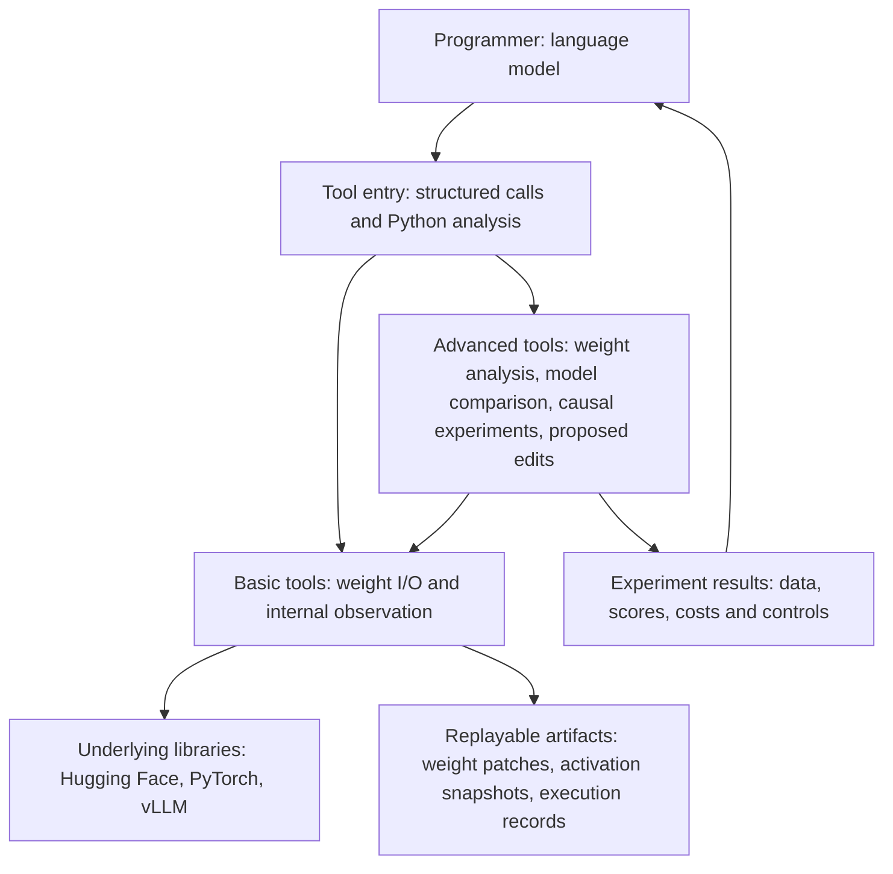

# WSP-toolkit architecture research

2026-11-08. **WSP-toolkit provides researchers and language models with tools for observation, interpretation, intervention, weight editing, and evaluation.** Underlying libraries perform computation and file I/O. This document records architecture references and method sources. The [general tool design](tool-design.md) is authoritative for the current implementation, interfaces, and development order.

## OpenWSP as a reference

OpenWSP places weight storage, a persistent Python kernel, and forward execution behind a common interface. Its MCP (Model Context Protocol) offers tensor listing, restricted slice reads, Python execution, forward runs, edit saving, delta inspection, analysis, and patch import/export. Its analysis code calculates principal directions of change, rank, direction cosines, and relationships between directions and selected token embeddings. It has also explored weight reloading in vLLM, checking caches and model behavior after updates. These are useful baseline capabilities. [OpenWSP architecture](https://github.com/openwsp/openwsp/blob/8d09276736034f6874bb40e7019247c9541a5551/docs/architecture.md) · [MCP tool list](https://github.com/openwsp/openwsp/blob/8d09276736034f6874bb40e7019247c9541a5551/docs/mcp.md) · [Direction analysis](https://github.com/openwsp/openwsp/blob/8d09276736034f6874bb40e7019247c9541a5551/src/openwsp/inspection.py) · [vLLM reload implementation](https://github.com/openwsp/openwsp/blob/8d09276736034f6874bb40e7019247c9541a5551/src/openwsp/backends/vllm_weights.py)

MIT's original experiment 8 lists persistent Python, weight reading and writing, and budgeted forward passes. Reproductions should set permissions according to the original protocol. The general toolkit may separately provide temporary activation interventions, gradient analysis, training, or compression, with enabled capabilities identified for each experiment. Another related project, `weightspace`, exposes tensor slices, version rollback, and customizable probes. WeightLoop studies how existing weight-modification programs can repeat their work using new measured feedback. Future distinguishing capabilities should be demonstrated in real workflows, particularly whether **weight changes, internal computation changes, and final behavioral changes** can be linked into an inspectable analysis. [Original MIT work](https://rikiyat.github.io/blog/weight-space-programming/) · [Experiment 8 tool protocol](https://github.com/RikiyaT/lm_understand-logs/blob/main/exp8_math/runs/p50c/turns/t001/prompt.txt) · [weightspace](https://pypi.org/project/weightspace/0.2.0/) · [WeightLoop](https://arxiv.org/abs/2611.07319)

## Eight design directions

| Direction | Work to cover | Returned to the programmer |
|---|---|---|
| 1. Weight I/O and versioning | Locate tensors; read by layer or slice; apply, export, replay, and revert changes on copies | Tensor locations and shapes, base version, patches, and edit scope |
| 2. Internal observation and snapshots | Run the target model and record intermediate values and output scores at selected layers, tokens, attention heads, or modules | Filterable snapshots, statistical summaries, and readable data files |
| 3. Fine-tuning delta analysis | Extract differences between base and trained models; locate changes, their magnitudes, and principal directions | Layer-wise deltas, directions, rankings, provenance, and comparison conditions |
| 4. Similarity between models | Compare parameters, representations on the same inputs, and final answers; choose methods based on model relationships | Layer similarity, per-question changes, alignment, and applicability |
| 5. Causal localization | Test whether a component affects a behavior using replacement, disabling, restoration, and dose scans | Inspectable intervention controls, candidate components, and effect sizes |
| 6. Generate and combine edits | Turn identified directions into weight patches, merge training updates, prune, compress, or compensate | Candidate patches, parameter or resource changes, methods, and conditions |
| 7. Evaluation and workflow | Freeze candidates and evaluate target gains, side effects, and costs on the same questions; retain per-question results | Accuracy, failure cases, costs, and rerunnable configurations |
| 8. Model-facing interface | List tools by capability, find targets, manage budgets, and allow raw data reads after summaries | Explicit tool parameters, result IDs, usage, and resumable state |

The first two directions provide the foundation. Directions 3–7 build analyses and experiments from those capabilities. Direction 8 spans the toolkit and determines whether a programmer can use the tools independently.

## 1–2. Connecting basic interfaces to libraries

| Library | Reusable capability | Interface added by WSP-toolkit |
|---|---|---|
| Hugging Face Hub and Safetensors | Download pinned model versions. Safetensors stores tensors and supports reads by name and slice | Unified model and tensor locations, with correspondence among original weights, candidate edits, and exports. [Hub downloads](https://huggingface.co/docs/huggingface_hub/en/guides/download) · [Safetensors](https://huggingface.co/docs/safetensors/index) |
| Transformers and PyTorch | Load and save models, access parameters, and attach observation hooks to executing modules | Select sites in model-understandable terms, bind candidate weights, and collect aligned snapshots. [Transformers model API](https://huggingface.co/docs/transformers/en/main_classes/model) · [PyTorch module API](https://docs.pytorch.org/docs/stable/generated/torch.nn.Module.html) |
| Hugging Face PEFT | Load or merge lightweight fine-tuning updates, such as LoRA, which represents edits using two smaller matrices | Convert updates to actual changes in base-model coordinates and record layer, scaling, and provenance. [PEFT checkpoint format](https://huggingface.co/docs/peft/en/developer_guides/checkpoint) · [LoRA API](https://huggingface.co/docs/peft/en/package_reference/lora) |
| vLLM | Parallel generation, variants, and weight-update interfaces for particular versions and formats | Evaluate the same patch with a high-throughput backend, checking loaded versions and prefix caches. Prefix caches reuse computations for earlier inputs and need backend-specific handling after a weight change. [vLLM weight transfer](https://docs.vllm.ai/en/latest/training/weight_transfer/) · [Asynchronous updates](https://docs.vllm.ai/en/latest/training/async_rl/) |
| NNsight, TransformerLens, pyvene | Trace intermediate values, cache observations, and configure temporary interventions | Use a compatible implementation as a plugin, unifying site selection, snapshot formats, and intervention descriptions. [NNsight](https://arxiv.org/abs/2407.14561) · [TransformerLens](https://github.com/TransformerLensOrg/TransformerLens) · [pyvene](https://arxiv.org/abs/2403.07809) |

The proposed division uses **Transformers/PyTorch for detailed analysis and vLLM for batch evaluation**. Both paths share model versions, patches, and evaluation tasks. vLLM inference formats may shard or merge matrices or quantize values to fewer bits. Validate hot updates for each supported version and model, then check fixed-input outputs and cache state. Experiment entry points should declare capabilities such as observable standard attention layers, batch generation, and direct loading of a given patch format. Layer types can differ within an architecture, as in Qwen3.5 hybrid attention. [OpenWSP vLLM update validation](https://github.com/openwsp/openwsp/blob/8d09276736034f6874bb40e7019247c9541a5551/src/openwsp/backends/vllm_weights.py) · [Qwen3.5 adapter](../src/weight_programming/qwen35_backend.py)

The foundation should standardize three artifact types. **Weight patches** record model version, tensors, and locations, distinguishing proposal precision from stored precision. **Activation snapshots** record model version, inputs, layers, token positions, and intermediate values, distinguishing prefill from token-by-token generation and raw tensors from aggregated statistics. **Experiment records** bind patches and snapshots to run parameters, samples, scoring rules, and actual usage. A site called “layer 15” may mean a layer input, output, or submodule; snapshots must preserve that distinction. [OpenWSP edit format](https://github.com/openwsp/openwsp/blob/8d09276736034f6874bb40e7019247c9541a5551/docs/edit-format.md) · [Forward service](../research/reports/forward-service.md)

## 3–4. Three levels of evidence for fine-tuning directions and similarity

Model similarity involves at least three questions. Advanced tools should select an applicable comparison route based on the relationship supplied by the user.

| Evidence | Possible calculations | Usage |
|---|---|---|
| Weight changes | Same-base per-tensor deltas, changed rows and columns, norms, SVD (principal directions), overlap between directions, trajectories across checkpoints, and merging conflicts | Direct subtraction requires the same base and parameter coordinates. For different bases, check component correspondence even if matrix shapes match. [Task Arithmetic](https://arxiv.org/abs/2212.04089) · [Git Re-Basin](https://arxiv.org/abs/2209.04836) |
| Internal representations | Run both models on the same inputs and compare intermediate values or structure. CKA compares how the models distinguish examples; SVCCA compares correlations among principal directions | Use the same samples and explicit token or span alignment. Direct deltas apply to aligned same-origin sites; sample-level similarity accommodates different widths. [CKA](https://proceedings.mlr.press/v97/kornblith19a.html) · [SVCCA](https://arxiv.org/abs/1706.05806) |
| Final behavior | Compare per-question answers, accuracy, repetition or excessive length, target-token probabilities, and runtime costs | When tokenizers differ, prefer scores on the same text task. Token-probability comparisons require a defined shared vocabulary or comparison target. [LM Evaluation Harness](https://github.com/EleutherAI/lm-evaluation-harness) |

First establish the relationship. **Fine-tuned versions of the same base** permit coordinate-wise deltas. **Independently trained models of the same architecture** may permute internal units; validate architectural alignment before interpreting parameter distances. **Different architectures** are best compared through representations and behavior on the same texts. Transferring internal edits requires a separately testable correspondence. [Git Re-Basin](https://arxiv.org/abs/2209.04836) · [CKA](https://proceedings.mlr.press/v97/kornblith19a.html)

A first advanced tool can be a **fine-tuning change report**. Given a base and fine-tuned model or LoRA, it reports layer-wise change, principal directions, actual edit scope, and how those directions affect intermediate values and outputs on specified inputs. Ordinary LoRA factors can be expanded into an effective matrix update using the implementation's scaling; the PEFT adapter handles variants. Comparing multidirectional updates can also measure angles between principal direction sets. Report overall and layer-wise metrics separately so large matrices do not obscure smaller layers. [LoRA](https://arxiv.org/abs/2106.09685) · [OpenWSP geometry analysis](https://github.com/openwsp/openwsp/blob/8d09276736034f6874bb40e7019247c9541a5551/src/openwsp/inspection.py) · [Existing LoRA analysis](../src/analyze_delta.py)

One simple way to connect directions to computation applies two candidate updates to **the same base activation**. For a linear layer, calculate `ΔW × x`: `ΔW` is the weight change, `x` is the base model's input to the layer, and their product is the local output change. This provides local functional evidence; run the full model to observe how later layers process the change. [Task Arithmetic](https://arxiv.org/abs/2212.04089) · [Direction comparison plan](../research/protocols/mit-wsp-reproduction.md)

Other representation tools include Logit Lens, which projects intermediate states onto the vocabulary, and Tuned Lens, which uses an additionally trained transform. Linear probes predict concepts with a small model; sparse autoencoders decompose complex activations into more inspectable features. These optional analyses should record training data, layers, and feature dictionaries. [Tuned Lens](https://arxiv.org/abs/2303.08112) · [Sparse feature analysis](https://transformer-circuits.pub/2024/scaling-monosemanticity)

With training data and multiple saved checkpoints, analysis can examine when directions appear and which training examples may influence behavior. TRAK is a reference for a training-data attribution plugin with additional data and compute requirements. Broader weight-space research includes constructing weights from programs or generative models. Tracr compiles algorithms written in a specific language into small Transformer weights, making it useful for tool validation with known behavior. [TRAK](https://arxiv.org/abs/2303.14186) · [Tracr](https://arxiv.org/abs/2301.05062) · [Weight-space survey](https://arxiv.org/abs/2603.10090)

## 5–6. From clues to proposed weight edits

| Task | Methods worth wrapping | Toolkit responsibilities |
|---|---|---|
| Test whether a component affects behavior | Activation patching, component disabling, restoration tests, and gradient-based candidate ranking when needed | Record clean, perturbed, and restored results on the same inputs, with sites, metrics, and intervention magnitudes. Gradient-based approximate localization has separate permission; verify key candidates with direct interventions. [Activation patching](https://arxiv.org/abs/2309.16042) · [AtP*](https://arxiv.org/abs/2403.00745) |
| Change a class of answers with a clear objective | Direction projection, ROME single-fact editing, MEMIT batch editing | Accept targets and data, produce reviewable patches, and record effects on related and unrelated tasks. ROME/MEMIT knowledge-editing plugins declare data and optimization permissions. [ROME](https://arxiv.org/abs/2202.05262) · [MEMIT](https://arxiv.org/abs/2210.07229) · [EasyEdit](https://aclanthology.org/2024.acl-demos.9/) |
| Combine existing training updates | Task-vector addition, subtraction and scaling; TIES conflict handling; DARE random retention and scaling | Unify same-base update representations and report norms, conflicts, and candidate versions before and after merging. A general merging library can act as an execution plugin. [Task Arithmetic](https://arxiv.org/abs/2212.04089) · [TIES](https://arxiv.org/abs/2306.01708) · [DARE](https://arxiv.org/abs/2311.03099) · [MergeKit](https://aclanthology.org/2024.emnlp-industry.36/) |
| Retain capability with fewer weights or less compute | Wanda scoring, SparseGPT local compensation, structural pruning, quantization, and low-rank compression | Record calibration data, removals, compensation, final weight format, and evaluation separately. Structural changes, precision changes, and deployment speed each require evidence. [Wanda](https://arxiv.org/abs/2306.11695) · [SparseGPT](https://arxiv.org/abs/2301.00774) · [LLM-Pruner](https://arxiv.org/abs/2305.11627) · [LLM Compressor](https://github.com/vllm-project/llm-compressor) |

A complete example is reducing loops in mathematical reasoning. Collect looping and non-looping outputs on practice questions, select alignable spans, and capture candidate-layer intermediate values. Restore or disable key components to check whether changes match expectations. The programmer then writes a Python patch and compares several magnitudes. Finally, freeze the candidate and compare accuracy, repetition, length truncation, and average usage on held-out questions. The discovered direction and original direction can be compared in the same coordinates and on common inputs. [MIT experiment 8](https://rikiyat.github.io/blog/weight-space-programming/) · [Independent evaluation protocol](../research/reports/math500-evaluation.md)

## 7–8. Connecting tools into workflows

Provide two entry points. Common tasks use **structured tools**, such as listing observable layers, comparing patches, or running two versions on the same input. New ideas use a **persistent Python workspace** to read selected results, write analysis code, and submit candidate edits. Both share permissions and records. CLI, Python, and MCP can call the same service layer. [OpenWSP interface design](https://github.com/openwsp/openwsp/blob/8d09276736034f6874bb40e7019247c9541a5551/docs/architecture.md)

Tool inputs should specify model, version, site, data, and budget. Return large matrices as file IDs, with dimensions, major changes, and a small preview in the response; raw data can then be read by slice. Long tasks should provide run IDs, progress, artifacts, and error locations. Record which observations produced each patch and which questions were used for design versus final confirmation. Each step should be independently replayable. To assess whether a programmer provides benefit, compare fixed recipes or simple search with the same tools and budget, including random-site or equal-norm controls. [OpenWSP MCP](https://github.com/openwsp/openwsp/blob/8d09276736034f6874bb40e7019247c9541a5551/docs/mcp.md) · [Activation-patching controls](https://arxiv.org/abs/2309.16042) · [Five-condition norm control](../research/reports/ties-merging-study.md)

## From research to implementation

See the [integration roadmap](tool-design.md#9-existing-implementations-and-integration-roadmap) for existing implementations, interface consolidation, and new methods. Classify new papers by their objects, such as activations, weights, or outputs; capabilities, such as reading, comparison, or temporary intervention; and required evidence, such as precise site coordinates, controlled effects, or complete task results. Add methods or views when inputs and outputs match. Add separate tool entries for independently managed objects, such as sparse dictionaries with model- and site-specific requirements. Charts reuse registered numeric artifacts.

Interpretability tools can produce three distinct results. BertViz, Ecco, and LIT provide observation and presentation to help select components. Tuned Lens, concept probes, and sparse dictionaries extract readable information from internal states. Activation patching, path patching, and circuit screening test output changes after modifying internal computation. Papers, existing tool mappings, and implementation plans are collected in the [interpretability design](tool-design.md#10-interpretability-tool-implementation). [BertViz](https://aclanthology.org/P19-3007/) · [Tuned Lens](https://arxiv.org/abs/2303.08112) · [Path Patching](https://arxiv.org/abs/2304.05969)
