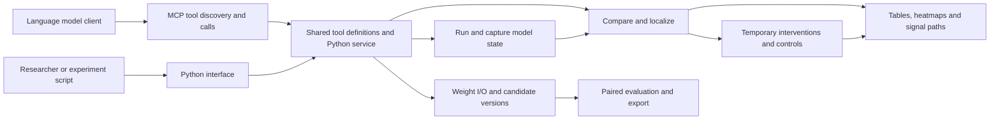

# WSP-toolkit tool design

WSP-toolkit gives researchers and language models general tools for model inspection, interpretation, intervention, editing, and evaluation. **Activations** are intermediate values produced as a model processes input. Users can inspect activations, compare models, test a component's effect on output, and edit weights. A **weight patch** is a separately saved and replayable weight modification. Qwen 0.6B and 4B professional workflows are application experiments. Tools accept host-registered models and data, and users can use each group of capabilities independently.

This document shares tool IDs with the [tool catalog](tool-catalog.json). Section 9 maps current implementations to the roadmap. Existing capabilities use their original code paths; new methods are registered separately. The interfaces below describe target contracts. Actual availability depends on the release and backend capability tables. See [architecture research](architecture.md), [installation scope](installation.md), and the [implementation and validation inventory](tool-inventory.md).

- [Architecture](#1-how-tools-form-an-experiment) · [Shared objects and patches](#2-objects-shared-by-all-tools) · [Basic tools](#3-basic-tools)
- [Advanced analysis](#4-advanced-analysis-tools) · [Advanced editing](#5-advanced-editing-tools) · [Evaluation and access](#6-evaluation-and-access-tools) · [MCP and Python interfaces](#mcp-and-python-interfaces)
- [Training, editing and deployment plugins](#7-training-editing-and-deployment-plugins) · [Three delivery stages](#8-three-delivery-and-experiment-stages) · [Existing implementations and integration roadmap](#9-existing-implementations-and-integration-roadmap) · [Interpretability implementation](#10-interpretability-tool-implementation)

## 1. How tools form an experiment



| Tool layer | Responsibilities | Implementation |
|---|---|---|
| Basic weights | Register models, read tensors, create patches and versions | `tensor_store.py`, `model_registry.py`, `patches.py` |
| Basic execution | Forward passes, snapshots, restricted Python | `hf_backend.py`, `qwen35_backend.py`, `forward_service.py`, `cpu_kernel.py`, `artifacts.py` |
| Advanced analysis and editing | Deltas, representation comparison, interventions, projection, merging, pruning | `delta_tools.py`, `comparison_tools.py`, `representation_tools.py`, `intervention_tools.py`, `editing_tools.py`, continuing to call existing computation modules |
| Evaluation and access | Evaluate under fixed configurations, expose tools, record runs and budgets | `evaluation_tools.py`, `protocol.py`, `tool_registry.py`, `mcp_server.py`. MCP and Python share a registry |

The initial general interfaces connect existing Qwen3, Llama, and Qwen3.5 backends. An **adapter** is a small code layer that translates a model's actual module names, tensor shapes, and observable sites into tool descriptions. Each model declares weight reading, forward execution, site capture, temporary intervention, gradients, editing, and export capabilities in `describe_model`. Analysis, plotting, budgeting, and evaluation use common data formats. New models register by capability; callers configure specific model names and professional tasks. PyTorch and Transformers provide detailed observation; vLLM is planned for batch evaluation of validated checkpoints. Both paths share versions, inputs, and run records. Hot updates require separate backend validation. [NNsight](https://arxiv.org/abs/2407.14561) · [pyvene](https://arxiv.org/abs/2403.07809) · [Transformers model API](https://huggingface.co/docs/transformers/en/main_classes/model) · [vLLM weight transfer](https://docs.vllm.ai/en/latest/training/weight_transfer/)

| Generality convention | Implementation requirement |
|---|---|
| Use a capability across models | Calls supply `variant_id` and adapter-registered sites. The adapter supplies original module names, attention types, and tensor axes. Unknown sites or unsupported operations report a specific reason before execution |
| Support independent research tasks | Snapshots, heatmaps, concept probes, model comparison, temporary interventions, and evaluation can run directly on the base. Sessions without checkpoint write permission can use enabled observation tools |
| Replace metrics and tasks | `MetricSpec` declares what to measure and how to align input/output, such as token margins, classification scores, or task scores. Gradient attribution accepts differentiable scores; complete task scores can support separate controlled evaluation |
| Support different internal structures | Qwen3 and Llama share a generative backend; Qwen3.5 uses a hybrid-layer backend. Encoders use `predict` for classification scores and reuse snapshots and probes. Record validation scope by backend, model version, and method |

Model adapters handle model-specific details. The backend's `observation_sites()` provides current sites, run modes, and array axes; the shared service writes these descriptions into snapshots. For example, `block.4.attention.probs` is registered only if the model provides attention matrices. Tools expose methods according to these capabilities and host permissions. Structural pruning, quantization, and sparse feature dictionaries declare additional conditions, such as module shape or the checkpoint used to train a dictionary. Common algorithms can read generated numeric files across model backends. [Current backend](../src/weight_programming/hf_backend.py) · [NNsight](https://arxiv.org/abs/2407.14561) · [pyvene](https://arxiv.org/abs/2403.07809) · [TransformerLens model adapters](https://transformerlensorg.github.io/TransformerLens/content/model_tables.html)

```python
class ModelAdapter(Protocol):
    """Connect model-specific sites and run capabilities to the shared service."""
    def describe(self) -> ModelDescription: ...
    def resolve_site(self, site_id: str, operation: str) -> BoundSite: ...
    def run(self, request: ForwardRequest, probes: tuple[BoundProbe, ...]) -> ForwardResult: ...
```

In this illustration, `BoundSite` includes the actual module, input or output port, axes, and supported operations. The service resolves an observation site against the model with `resolve_site` before passing it to the backend. Algorithms that analyze saved arrays read artifacts directly and can be recomputed on a machine without a model process.

## 2. Objects shared by all tools

| Object | Minimum fields | Code convention |
|---|---|---|
| Model `ModelRef` | `base_id`, checkpoint provenance and pinned revision, architecture, file digests, tokenizer and chat-template digests | Local paths and Hub names are used for registration only. Identity uses file-content digests in stable order. Retain existing `WeightStore` identity for replaying older experiments |
| Model version `VariantRef` | `variant_id`, `base_id`, `parent_variant_id`, `patch_id`, format | Each run explicitly supplies a version. New version IDs derive from the parent and patch content. The parent remains independently runnable |
| Tensor `TensorRef` | Full parameter name, shape, original precision, axis semantics, shard, tied-weight group | The architecture adapter registers axis semantics. A standard linear weight is `[output channel, input channel]`. Parameters sharing weights are written and validated as a group |
| Patch `PatchRef` | `patch_id`, `base_id`, `parent_variant_id`, edit list, method, source artifact IDs | Each entry records parent and new tensor digests, shape, and original precision. The first version stores complete replacement tensors in Safetensors. Tools may accept slice edits and save them into complete tensor copies |
| Site `SiteRef` | Logical location, layer number, `port` (input or output), axes, applicable run modes | `block.12.residual_out` is layer 12 output; `block.12.mlp.down_proj.input` is the feed-forward down-projection input. Public block numbering starts at 0. When adapting the legacy interface, layer `n` residual output maps to `hidden_{n+1}` and embeddings to `hidden_0` |
| Snapshot `SnapshotRef` | `variant_id`, `run_id`, sample IDs, input positions or token IDs, valid positions, sites, axes, `artifact_id` | Tokens are the text pieces actually read by the model; the adapter interprets positions. Generative models distinguish prompt prefill and token-by-token generation; classifiers record encoded-input positions |
| Metric `MetricSpec` | `metric_id`, implementation version, target site or output, aggregation, differentiability flag | Intervention, attribution, and evaluation refer to the same metric. Reports record controls, denominator, and sample unit |
| Evidence `EvidenceRef` | `kind`, axis labels, sample IDs, values or figure references, source run, method, baseline | Distinguish raw activations, attribution scores, controlled effects, representation similarity, and circuit edges. Read values before rendering; preserve scales, units, and missing sites in figures |
| Run `RunRef` | Tool and implementation version, request digest, version, data split, backend, seed, status, usage, artifacts | Record actual forward count, input and output tokens, time, and bytes written. Failed runs also record incurred usage and the failing step |

The host registers data referenced by `dataset_id`, `split`, and sample ID. Training, calibration, development, and final test data are registered separately. Calibration data collect internal statistics. The host retains the final test set, freezes submitted candidate versions, and scores them. Large tensors, full batches, and per-question details use artifact IDs; model calls return summaries and limited previews.

### Writing and applying patches

1. `create_patch` reads current values from the specified parent and constructs edits in a separate staging directory. Replacement values, deltas, and slice coordinates are validated. Values are converted back to the target tensor's original precision, then checked for finite values and actual changes. Changes lost to rounding are counted separately.
2. Compute all entry digests. Write complete Safetensors and manifest files, then publish by same-filesystem directory rename under the patch ID's publication lock. Readers consult the publication directory only. For concurrent submissions of the same patch, later calls validate published content and return the same ID. Validation failures identify the tensor.
3. `apply_patch` checks the base, parent, parent tensor digests, and tied groups, then registers a candidate `variant_id`. At runtime, the version resolver selects the most recent replacement for each tensor and passes read-only snapshots to the adapter. The HF worker binds snapshots serially, restoring parameters and removing probes on exit.
4. `revert_patch` returns the registered parent ID. Switching versions changes the ID supplied to the next call. Retrying the same request returns the existing patch or run record; the same request ID with different inputs raises an error.

`VersionStore` reuses `WeightStore` Safetensors indexing and edit validation. Fully validated patches are published atomically. Complete model exports retain the original configuration, tokenizer, generation configuration, and weight index, rewriting affected shards at original precision. Load the complete export in a new workspace and check candidate weights and forward readings. [Patch example](../examples/mcp_patch.py) · [OpenWSP patch format](https://github.com/openwsp/openwsp/blob/8d09276736034f6874bb40e7019247c9541a5551/docs/edit-format.md) · [Safetensors](https://huggingface.co/docs/safetensors/index)

## 3. Basic tools

These names describe tool contracts. An input `artifact_id` points to a registered file or array, avoiding millions of numbers in a model call.

| Tool and sources | Inputs and returns | Implementation and acceptance |
|---|---|---|
| `register_model`<br>Register a checkpoint. [Hub versioned downloads](https://huggingface.co/docs/huggingface_hub/en/guides/download) · [Safetensors](https://huggingface.co/docs/safetensors/index) | Host supplies a local checkpoint directory or Hub repository and full commit hash. Returns `base_id`, initial `variant_id`, architecture, and support status | Use `snapshot_download(revision=...)` for pinned Hub contents. Reuse `WeightStore` to check files and shards and register configuration, tokenizer, and weight digests. Ordinary programmers use registered models. Re-registering identical content must return the same ID; weight or chat-template changes must change identity |
| `describe_model`<br>Describe available model operations. [OpenWSP MCP](https://github.com/openwsp/openwsp/blob/8d09276736034f6874bb40e7019247c9541a5551/docs/mcp.md) · [PyTorch modules](https://docs.pytorch.org/docs/stable/generated/torch.nn.Module.html) | `variant_id`. Returns layer types, sites, context limits, run modes, patch capabilities, and backends | Read registry configuration; the adapter declares capabilities. Mark standard attention and other layers individually in hybrid architectures. Verify each public site captures its declared shape on a real model. Model information requires no model run |
| `list_tensors`<br>Find parameters. [OpenWSP MCP](https://github.com/openwsp/openwsp/blob/8d09276736034f6874bb40e7019247c9541a5551/docs/mcp.md) | `variant_id`, optional module prefix or layer, pagination cursor. Returns names, shapes, precision, axes, tied groups, and source versions | Reuse the Safetensors index and registered weight metadata; overrides come from patch manifests. Paginate in stable order with cursors bound to version and filters. Verify complete pagination against the real index and repeat ordering |
| `read_tensor`<br>Read a small weight slice. [Safetensors slicing](https://huggingface.co/docs/safetensors/index) · [OpenWSP MCP](https://github.com/openwsp/openwsp/blob/8d09276736034f6874bb40e7019247c9541a5551/docs/mcp.md) | `variant_id`, tensor name, half-open interval per axis. Returns shape, original precision, source version, small preview or `artifact_id` | Resolve the file through the version chain, validate bounds and byte budget, then read with `safe_open(...).get_slice(name)[...]`. Support reads from individual shards. Check a real shard slice elementwise against the full tensor and verify expected parent–candidate differences |
| `create_patch`<br>Save a set of proposed edits. [MIT weight-space programming](https://rikiyat.github.io/blog/weight-space-programming/) · [OpenWSP patch format](https://github.com/openwsp/openwsp/blob/8d09276736034f6874bb40e7019247c9541a5551/docs/edit-format.md) | `parent_variant_id`, `replace` or `add` edits, method and provenance. Slices of one tensor must not overlap. Returns `patch_id`, touched tensors, realized change count and norm after rounding | Stage, validate, and publish as in section 2. Reuse `EditPolicy` constraints and preserve parent precision and untouched regions. Submit multi-tensor edits to a real model and check each change. Reject wrong shapes, inconsistent aliases, or excess budget before publication |
| `apply_patch`<br>Register a runnable candidate. [OpenWSP patch application](https://github.com/openwsp/openwsp/blob/8d09276736034f6874bb40e7019247c9541a5551/docs/mcp.md) | `parent_variant_id`, `patch_id`. Returns `variant_id`, parent, and affected tensors | `versions.py` validates parent and contents, then writes a candidate manifest; model loading binds it. Identical requests return the same candidate ID; another parent reports a conflict before execution |
| `revert_patch`<br>Return to the parent. [OpenWSP editing model](https://github.com/openwsp/openwsp/blob/8d09276736034f6874bb40e7019247c9541a5551/docs/architecture.md); parent return is this project's interface design | `variant_id`. Returns the immediate parent ID, or a clear error for a base with no parent | Look up the version record. Pass the result to `model_forward` or `read_tensor`. Verify parent tensor digests and fixed-input output against the same backend's stated tolerance |
| `export_patch` / `import_patch`<br>Exchange weight edits. [OpenWSP patch format](https://github.com/openwsp/openwsp/blob/8d09276736034f6874bb40e7019247c9541a5551/docs/edit-format.md) | Export takes `patch_id` and returns manifest and weights. Import takes registered files and returns the same-content `patch_id` and applicable parent | Use Safetensors and a versioned manifest. Validate format, file digests, parent, and every entry before the common publication process. In another real workspace, import against the same parent checkpoint, check weights individually, and compare fixed-input output |
| `export_model`<br>Deliver a complete model. [Transformers checkpoint API](https://huggingface.co/docs/transformers/en/main_classes/model) | `variant_id`, export format. Returns checkpoint path, exported base ID, and format | Resolve candidate weights and rewrite affected Safetensors shards. Copy tokenizer, configuration, and template. Reload in a new workspace and check weights and fixed forward results. Validate vLLM compatibility separately |
| `model_forward`<br>Run the target model. [MIT experiment 8 tool protocol](https://github.com/RikiyaT/lm_understand-logs/blob/main/exp8_math/runs/p50c/turns/t001/prompt.txt) · [OpenWSP forward API](https://github.com/openwsp/openwsp/blob/8d09276736034f6874bb40e7019247c9541a5551/docs/mcp.md) | `variant_id`, input, mode, budget, optional observations. Retains `generate` and `teacher_forced` sequence scoring. `predict` supports DistilBERT single-label classification scores. Supply only settings needed by the mode | Reuse `ForwardService` and `BudgetLedger`, adapting existing `original`/`edited` bindings to the version resolver. Adapters declare input types, modes, output axes, and site capture capabilities. Verify real generative tokens, scores, and usage, and compare classifier results with direct inference |
| `read_artifact`<br>Read snapshots, matrices, or per-question results. [OpenWSP restricted reads](https://github.com/openwsp/openwsp/blob/8d09276736034f6874bb40e7019247c9541a5551/docs/mcp.md) | `artifact_id`, array key or record filter, slice or page size. Returns small data, type, axes, and source `run_id` | `artifacts.py` reads registered formats with established libraries, checking ownership, bytes, coordinates, and data permissions. Check that a complete snapshot summary agrees with recomputation from slices; final-test per-question labels are host-only |
| `execute_python`<br>Allow programmers to write analysis. [MIT original](https://rikiyat.github.io/blog/weight-space-programming/) · [OpenWSP Python kernel](https://github.com/openwsp/openwsp/blob/8d09276736034f6874bb40e7019247c9541a5551/docs/architecture.md) | `session_id`, `variant_id`, `code`, optional `input_artifacts`, `outputs`, and `edits`. Returns limited text, run ID, array and patch IDs | Reuse the Linux-isolated `CPUKernel` process. The host mounts a fixed weight version and supplies requested read-only arrays. Python uses `load`, `read_array`, and `save_array`; the host validates proposals with `VersionStore.create_patch`. Real weight slices verified cross-call variables, readable snapshots, and replayable candidates |

`model_forward` observation options accept sites, input positions or generation steps, slices or aggregation, and return snapshot IDs, shapes, and statistics. PyTorch hooks and existing backends capture embeddings, residuals, feed-forward inputs, and supported attention matrices. Residuals are the main state passed between layers. Given-text scores and snapshots can be captured in one forward pass. The current generation path obtains activation summaries by replaying sampled output, recording collection mode and usage separately. Validate shape, valid tokens, output with and without observation, and cleanup at each site. Attention-head outputs, key-value caches, expert routing, and gradients are registered and validated separately on real models. [NNsight](https://arxiv.org/abs/2407.14561) · [pyvene](https://arxiv.org/abs/2403.07809)

### A slice patch request

```json
{
  "parent_variant_id": "var_parent",
  "edits": [
    {
      "tensor": "model.layers.12.mlp.down_proj.weight",
      "op": "add",
      "region": [[0, 16], [32, 40]],
      "value_artifact_id": "art_delta_16x8"
    }
  ],
  "method": "custom_python"
}
```

This request adds a `16 × 8` array to rows 0–15 and columns 32–39 of the target matrix in the parent version. Omitting `region` selects the full tensor. `value_artifact_id` can come from `execute_python` or an advanced recipe. The service returns `patch_id` and the realized change after writing at original precision. The next `apply_patch` call explicitly supplies the parent and patch IDs.

### Code example: preserving actual weight precision

```python
import torch


def build_replacement(parent, region, delta):
    """Build a complete replacement tensor for a validated floating-point slice."""
    replacement = parent.clone()
    # Compute in FP32, then write in the checkpoint's original precision.
    updated = parent[region].float() + delta.float()
    replacement[region] = updated.to(parent.dtype)
    if not torch.isfinite(replacement[region]).all():
        raise ValueError("Non-finite value after writing at original precision")
    # Report the realized change; rounding may absorb small deltas.
    realized_delta = replacement[region].float() - parent[region].float()
    return replacement, realized_delta
```

This illustration covers the initial FP16, BF16, and FP32 floating-point tensors. The service validates shape, permissions, and budget before calling it. Every slice axis must be in range and the input array must match exactly. Cloning the parent before changing the slice preserves other positions and reveals the change actually saved.

### Code example: recording layer inputs at selected tokens

```python
from contextlib import contextmanager


@contextmanager
def capture_linear_input(module, token_positions, observations):
    """Record linear-layer inputs at selected positions during a full forward pass."""
    def observe(_module, args):
        # Linear inputs have shape [batch, token, channel]; slice before saving.
        values = args[0][:, token_positions, :].detach().cpu()
        observations.append(values.clone())

    handle = module.register_forward_pre_hook(observe)
    try:
        yield
    finally:
        handle.remove()
```

This function covers a full forward pass where samples share positions. The production interface resolves logical sites to real modules through the adapter, validates token positions, and attaches observation within `backend.activate(snapshot)`. During token-by-token generation it records each step's input and global token position. Observations from both processes are archived by model version and site ID. [PyTorch forward hooks](https://docs.pytorch.org/docs/stable/generated/torch.nn.Module.html)

## 4. Advanced analysis tools

Analysis tools produce results for further verification. Reports record versions, samples, corresponding sites, and computation methods. Programmers can pass direction or sample IDs directly to the next tool.

| Tool and sources | Inputs and returns | Implementation and acceptance |
|---|---|---|
| `analyze_weight_delta`<br>Explain changes from fine-tuning or editing. [Task Arithmetic](https://arxiv.org/abs/2212.04089) · [LoRA](https://arxiv.org/abs/2106.09685) · [OpenWSP direction analysis](https://github.com/openwsp/openwsp/blob/8d09276736034f6874bb40e7019247c9541a5551/src/openwsp/inspection.py) | `base_variant_id`, candidate or registered PEFT adapter, tensor selection, optional second candidate and input snapshots. Returns layer-wise changes, changed elements and columns, principal directions, direction similarity, and local output effects | Read `W₁−W₀` layer by layer in shared parameter coordinates and accumulate squared sums, change counts, and dot products. Reuse `compare_edits` and `src/analyze_delta.py`. PEFT resolves adapters into common coordinates; standard linear LoRA is `scale × (B @ A)`, with actual per-layer scales and transpose rules recorded. Separately report theoretical delta, merged original-precision delta, and actual forward pass for a real adapter |
| `compare_models`<br>Compare weights, representations, and results. [CKA](https://proceedings.mlr.press/v97/kornblith19a.html) · [Git Re-Basin](https://arxiv.org/abs/2209.04836) | Two `variant_id` values, common samples, `views`, sites, and sample alignment. Returns comparison type, weight geometry, layer similarity, or per-question behavior differences | Weight comparison calls `analyze_weight_delta` or uses a validated parameter alignment. Representation comparison issues two `model_forward` observation requests, aligns samples, and computes a centered linear CKA matrix. Behavior comparison calls `evaluate_variants`. Real model self-comparison should approach 1 at sites with variance; reordering samples changes comparison; reject weight comparison without parameter correspondence |
| `score_preferences`<br>Check relative preference for better answers after editing. [DPO relative log probabilities](https://arxiv.org/abs/2305.18290) | Candidate and reference versions, preference-pair IDs, score aggregation. Returns per-pair margins, change relative to reference, token lengths, and summary | Run `teacher_forced` on preferred and dispreferred answers to the same prompt. Sum answer-token log probabilities only and calculate `candidate margin − reference margin`. DPO controls use sequence sums; token means can be separate diagnostics. Reuse forward tools; manually check several real generated or labeled pairs and validate behavioral gains with task scores |
| `run_intervention`<br>Temporarily replace or mask activations to test effects. [Activation patching](https://arxiv.org/abs/2309.16042) · [pyvene](https://arxiv.org/abs/2403.07809) | One version, clean and corrupt samples, sites, token positions, channels, intervention type, metric. Returns baseline, corrupt and intervention results and differences, with snapshots or per-question records | Reuse the three runs in `ActivationPatchingStudy.run` and temporary hooks in `replace_activation`. Initial replacement supports equal-length inputs and explicit sites validated on real models; a separate `zero` path can be added. Remove hooks on exit. Record three forward passes and verify fixed-input outputs and original weight digests after restoration |
| `localize_behavior`<br>Find candidate components for a behavior. [Activation patching](https://arxiv.org/abs/2309.16042) · [AtP*](https://arxiv.org/abs/2403.00745) | Candidate sites, sample groups, target metric, per-round budget, review samples. Returns intervention-effect ranking, failures, and per-run records | Reuse clean and corrupt forward passes and needed snapshots for each sample, then run exact interventions by site. Compare same-size random sites or self-patching. Rank on a discovery set and verify on held-out development data, aggregating effects by question. A separately authorized gradient plugin can pre-rank sites; selected sites still receive exact interventions. Report supporting sample counts, effect direction, usage, and review results |

### Computing fine-tuning deltas

1. **Find correspondence.** Check base, architecture, tensor names, shapes, and axes. Direct comparison requires explicit common parameter coordinates. Independently trained checkpoints can use different internal coordinates even with the same shapes. For a validated alignment map, record its version and validation.
2. **Read statistics before selecting matrices.** Per layer or block, calculate actual changed-element counts, absolute and relative magnitudes, and directions. Relative magnitude is `||ΔW|| / ||W₀||`; report why it is undefined when the denominator is zero. Compare two updates in the same coordinates using signed cosine, where positive values indicate similar directions. Apply SVD to selected matrices to extract principal change directions. Use `torch.linalg.svd` for small matrices and seeded, budgeted approximation for large matrices; record retained directions and reconstruction error. [OpenWSP direction analysis](https://github.com/openwsp/openwsp/blob/8d09276736034f6874bb40e7019247c9541a5551/src/openwsp/inspection.py)
3. **Distinguish two deltas.** Standard LoRA represents updates as low-rank matrices; `scale` depends on configuration. Within supported scope, prefer PEFT's effective updates and merge semantics. Retain the theoretical update at calculation precision and the realized update readable after checkpoint merge. For adapters with additional transforms such as DoRA, take deltas from the installed PEFT version's actual merge and report unvalidated types explicitly. [PEFT checkpoint format](https://huggingface.co/docs/peft/en/developer_guides/checkpoint) · [PEFT LoRA](https://huggingface.co/docs/peft/en/package_reference/lora)
4. **Inspect the update's effect on inputs.** Take the parent version's linear-layer input `X[token, input channel]` and compute `X @ ΔW.T`. This estimates the layer-output change due to the weight update on those tokens. Add the bias delta if bias also changed. Compare full-model forward outputs afterward and record local and end-to-end effects separately.

### Aligning observations between models

| Relationship | Comparison |
|---|---|
| Same base or checked common coordinates | Compare corresponding weights, representations on the same inputs, and behavior. Candidate update directions can also be compared |
| Independently trained with a validated parameter map | Map supported tensors into common coordinates and compute geometry. Compare other parts through representations and task performance on common inputs |
| Different architectures or tokenizers | Compare the same questions at semantic positions, such as the end of each complete prompt. Activations can have different widths. Compare token scores directly only when tokens and probability events align; use the same task scores across models |

The core linear CKA code follows. Rows are aligned by sample and site; columns are each model's channels. Center columns, calculate sample similarity matrices, and compare them. If all centered samples are identical for a model, the site score is undefined.

```python
def linear_cka(x, y):
    """Compare representations of the same samples at two sites."""
    if x.ndim != 2 or y.ndim != 2 or x.shape[0] != y.shape[0] or x.shape[0] < 2:
        raise ValueError("At least two aligned sample rows are required")
    x, y = x.double(), y.double()
    x, y = x - x.mean(0), y - y.mean(0)
    left, right = x @ x.T, y @ y.T
    denominator = left.norm() * right.norm()
    if denominator.item() == 0:
        return None
    return ((left * right).sum() / denominator).item()
```

The tool checks finite values and the alignment table before execution and estimates matrix memory from sample count. For large sets, use a registered batched algorithm or a prespecified sample subset. Reports retain sample IDs, algorithm, sample count, and aggregation rule for recomputation. [CKA paper](https://proceedings.mlr.press/v97/kornblith19a.html)

### Evaluating an intervention

Run three conditions with the same target metric, for example the score difference between the correct answer token and a distracting answer token. Run the original input as `clean`, a key-information-corrupted input as `corrupt`, then replace the specified corrupt-input activation with the clean activation for `patched`. Report `patched−corrupt`, and report a recovery ratio when `clean−corrupt` meets a prespecified minimum magnitude. Retain both metrics per question. Recovery indicates that the selected component affects the metric under those inputs and interventions. After constructing a permanent weight patch, separately test full generation and held-out questions. [Activation-patching metrics and perturbations](https://arxiv.org/abs/2309.16042) · [Real paired activation intervention record](../research/reports/activation-patching-study.md)

## 5. Advanced editing tools

These tools produce candidate patches. For changes that retain dimensions, use `create_patch` to save them and `apply_patch` to select a candidate to run. Structural pruning or quantization changes checkpoint structure or representation and uses separately exported model versions with original-model and method metadata.

| Tool and sources | Inputs and returns | Implementation and acceptance |
|---|---|---|
| `project_weight`<br>Change a linear layer along a direction. [MIT weight-space programming](https://rikiyat.github.io/blog/weight-space-programming/) · [Arditi et al. direction removal](https://arxiv.org/abs/2406.11717) | Parent, target matrix, direction in the same output coordinates, column range, strength. The direction can be built from two aligned activation sets. Returns patch, change norm, and column range | Reuse `contrast_direction` for unit direction `u` and `project_output_direction` for `W[:, C] − strength × u × (uᵀW[:, C])`. First check observation-site channels against target output coordinates. At strength 1 the selected columns' component along `u` should approach zero, with other columns unchanged. Assess effects using a strength scan and equal-norm direction controls |
| `merge_updates`<br>Combine existing updates. [Task Arithmetic](https://arxiv.org/abs/2212.04089) · [TIES](https://arxiv.org/abs/2306.01708) | Update IDs from the same parent, method, coefficients or retention fraction, optional norm constraint. Returns patch, input and merged norms, retention, and sign-conflict statistics | Read effective deltas. Weighted merging computes `Σ αᵢΔWᵢ` per tensor. TIES trims small changes, chooses among conflicting signs, and aggregates agreeing updates. Reuse `ties_merge` and record trimming scope and variant. Recompute a result from two real updates; compare separate application, weighting, and equal-norm TIES |
| `prune_and_compensate`<br>Remove weights and optionally compensate. [Wanda](https://arxiv.org/abs/2306.11695) · [SparseGPT](https://arxiv.org/abs/2301.00774) | Parent, linear layer, calibration set, method, sparsity. Fixed-mask compensation also takes a Boolean array where `true` means removal. Returns patch, mask, actual zero fraction, and local reconstruction error | Collect valid input rows using `model_forward` observations. Wanda reuses `wanda_mask` in `src/paper_methods.py` and ranks each row by `abs(W) × sqrt(sum(X²))`. SparseGPT reuses `input_hessian` and `sparsegpt_reconstruct`, using joint input variation to compensate remaining weights. Compare original, pruning alone, and fixed-mask compensation on the same real layer inputs, then evaluate development-set task results separately |
| `compress_update`<br>Store an existing role update with fewer parameters. [LoRA](https://arxiv.org/abs/2106.09685) · [Low-rank compression](https://arxiv.org/abs/2403.07378) | Existing low-rank update, per-layer rank budget, optional calibration inputs. Returns a small update file, actual parameter count, reconstruction error, and optionally a registered weight patch | Reuse `truncate(A, B, rank)` and `weighted_truncate(A, B, C, rank)` from `src/delta_programming.py`. For input weighting, compute `Z = X @ A.T` then `C = Z.T @ Z / n` for low-rank input statistics. On a real update check target rank, size, error in `X @ ΔW.T`, role performance, and adapter loading. Record deployed size separately after merging into dense weights |

### Two pruning research questions

- **What to remove.** Collect real parent-version inputs on role or task calibration samples, excluding padding tokens. Wanda selects low-scoring weights within each output channel. Record layer target fractions, pre-existing zeros, actual removals, and compute budget. Use magnitude pruning as a simple control. [Wanda](https://arxiv.org/abs/2306.11695)
- **How to compensate.** Compare direct zeroing and SparseGPT compensation with the same mask to isolate mask selection. Existing `input_hessian` computes `2 XᵀX / n`; record valid token counts, damping, block size, and candidates. The local implementation supports fixed masks and adaptive block selection; identify the variant. Record `||X(W_new−W_old)ᵀ||²` on calibration and held-out inputs. Check second-order matrix memory before wide layers. [SparseGPT](https://arxiv.org/abs/2301.00774) · [Existing reconstruction study](../research/reports/reconstruction-study.md)

The first `prune_and_compensate` patches retain original matrix shapes. To establish efficiency gains, export an appropriate sparse kernel, quantized format, or structurally smaller model, and measure latency, throughput, and memory on the specified backend.

### Incorporating post-training methods

| Method | Toolkit use | Research control |
|---|---|---|
| Supervised fine-tuning and LoRA | Pass real pre/post-training updates to `analyze_weight_delta` to extract layer changes, effective rank, and effects on role inputs for `merge_updates` and `compress_update` | Ordinary role LoRA on the same data, with training steps, trainable parameters, and compute costs reported separately. [LoRA](https://arxiv.org/abs/2106.09685) |
| DPO preference optimization | `score_preferences` reuses candidate preference margins relative to a reference. This tool scores; a separately authorized backend trains | Compare ordinary DPO with programmatic edits on real preference pairs, and separately inspect held-out task performance. [DPO](https://arxiv.org/abs/2305.18290) |
| Teacher–student distillation | Turn a large model's role decisions, tool calls, and handoffs into training data for a 4B model. Analyze weight updates produced by real distillation | Compare role distillation, ordinary supervised updates, and weight-program edits using the same data and base, recording training and search costs separately. [Knowledge distillation](https://arxiv.org/abs/1503.02531) · [Role programming protocol](../research/protocols/multiagent-role-programming.md) |

### Code example: compare pruning compensation with the same mask

```python
from paper_methods import wanda_mask
from weight_programming.reconstruction import input_hessian, sparsegpt_reconstruct


def build_pruning_pair(weight, valid_inputs, fraction):
    """Build two candidates from the same inputs and mask."""
    # valid_inputs contains real-model layer inputs with padding excluded.
    energy = valid_inputs.double().square().sum(0)
    mask = wanda_mask(weight.double(), energy, fraction)
    # Both paths zero columns with zero calibration-input energy.
    mask[:, energy.eq(0)] = True
    pruned = weight.masked_fill(mask, 0)
    repaired, _, details = sparsegpt_reconstruct(
        weight, input_hessian(valid_inputs), prune_mask=mask
    )
    return pruned, repaired, mask, details
```

Both candidates use the same target removal mask. The first zeroes weights; the second adjusts remaining weights to compensate. The existing SparseGPT primitive also zeroes columns with zero calibration-input energy. For a formal comparison, include those columns in the fixed deletion condition for both paths and separately record the target mask, zero-energy columns, and actual zeros after saving. The service writes each candidate as a patch and compares them on held-out samples to estimate compensation and removal-site effects separately.

## 6. Evaluation and access tools

| Tool and sources | Inputs and returns | Implementation and acceptance |
|---|---|---|
| `evaluate_variants`<br>Compare original and candidates on the same tasks. [LM Evaluation Harness](https://github.com/EleutherAI/lm-evaluation-harness) · [Paired evaluation](../research/reports/math500-evaluation.md) | Baseline and candidate IDs, data split, scoring configuration, backend, generation configuration, budget. Returns per-question artifacts, summaries, differences, confidence intervals, and costs | `evaluation.py` retains generation and scoring paths and adds version binding and general scoring. Candidates share cases, prompts, seed scheme, and limits. Join results by `case_id` and repeat index; perform paired resampling clustered by case. Record warmup and timed runs separately. Verify counts, stop reasons, accuracy, and cost on real public tasks, recomputing summaries from saved details |
| `list_tools`<br>List currently available tools. [MCP discovery specification](https://modelcontextprotocol.io/specification/2026-07-28/server/tools) · [OpenWSP tool list](https://github.com/openwsp/openwsp/blob/8d09276736034f6874bb40e7019247c9541a5551/docs/mcp.md) | Python queries tools, methods, versions, parameters, and prerequisites using current configuration and optional `variant_id`. MCP clients use native `tools/list` | `tool_registry.py` provides discovery for both from one registry. Filter by implementation and permissions; adapters report model-specific capabilities through `describe_model`. Verify discovery agrees with call permissions |
| `get_run`<br>Inspect analysis or evaluation status. Based on the repository's [forward budget logging design](../research/reports/forward-service.md); the general record structure is defined here | `run_id`. Returns status, completed steps, budget usage, artifact IDs, and error code and location on failure | Connect `BudgetLedger` start/end records with artifact manifests. Append progress and write final success or failure status. A single worker may run long analyses in the background. Verify a real run is queryable from registration through completion, interrupted runs are identifiable, and only published artifacts are read |

### MCP and Python interfaces

**MCP (Model Context Protocol) is WSP-toolkit's standard interface for language-model clients. Python provides the computation and direct researcher interface. Both share tool definitions and Python implementation.** Researchers can use Python in scripts or notebooks. Clients discover tools through `tools/list` and call them through `tools/call`. The local service is read-only by default; hosts can separately authorize weight editing and activation interventions. [Installation and usage](installation.md#local-mcp-and-python-read-only-tools) · [MCP tool specification](https://modelcontextprotocol.io/specification/2026-07-28/server/tools)

| Layer | Responsibility |
|---|---|
| Tool registry | Register each tool once with name, version, input/output schemas, permissions, required model capabilities, and Python function. Existing `execute_python` and `model_forward` definitions and dispatch are the starting point |
| MCP adapter | Provide discovery and structured results from the registry. Pass arguments to the shared service and return protocol success or failure. Include concise text or readable resource links as needed by the client |
| Python service | Validate inputs, permissions, model capabilities, and budgets; execute the same function and record runs and artifacts. Python calls this layer directly. Functions operating on loaded tensors continue accepting tensor objects for research scripts |

**Return results according to size.** Small results return structured summaries. Activation snapshots, heatmaps, and weight patches live in the artifact service; MCP returns artifact IDs, type, shape or axes, and a limited preview when needed. Use `read_artifact` to read by layer, token, or slice. Long tasks return `run_id` for progress and final artifacts via `get_run`. Runs, artifacts, and workspaces use explicit IDs. [MCP tool results](https://modelcontextprotocol.io/specification/2026-07-28/server/tools#tool-result)

**Observation is enabled by default.** The service filters discovery by permissions and checks permissions, model capabilities, and artifact ownership on calls. Temporary intervention, weight writing, and `execute_python` each require explicit authorization. MCP and Python share validation; original-reproduction configurations retain existing tool arguments and experimental permissions.

**First validation sequence.** On a real model, call `describe_model → model_forward → read_artifact` to discover observable layers, capture an activation, and read a slice. Run the same configuration through Python and MCP and check sites, shapes, and values. Check that read-only discovery matches call permissions. Then add patches, pruning, and evaluation through the same entry point. [Existing tool dispatch](../src/weight_programming/tool_api.py)

### Tool results returned to the model

The following `analyze_weight_delta` result illustrates fields; IDs and numbers are examples.

```json
{
  "run_id": "run_delta_001",
  "status": "succeeded",
  "summary": {
    "scope": "same_weight_coordinates",
    "changed_tensors": 4,
    "top_tensor": "model.layers.12.mlp.down_proj.weight"
  },
  "artifacts": {"tensor_report": "art_delta_table", "top_directions": "art_delta_svd"},
  "usage": {"model_forwards": 0, "elapsed_ms": 156}
}
```

The programmer can inspect a layer with `read_artifact`, then pass a direction with explicit coordinates to `project_weight`. Failures return structured errors such as `UNSUPPORTED_SITE`, `BUDGET_EXCEEDED`, and `PARENT_MISMATCH`, plus affected versions or sites. The service ends the call at the error and records consumed resources. Long tasks can return `run_id` for retrieval through `get_run`. Run records include tool version, data, and backend configuration for replay with fixed inputs.

The original-reproduction configuration retains the two `tool_api.py` entry points and original parameters. General research configurations expose reading, snapshots, and read-only analysis by default, with intervention, editing, or development-set evaluation authorized as needed. Training and deployment plugins declare their own compute permissions. The host handles final testing, checkpoint registration, and external publication.

### How the service layer calls advanced tools

For a pruning recipe, `recipes.py` reads target weights from a version, requests calibration layer inputs from the observation service, and calls pure tensor functions. It then writes candidates through the patch service. Computation functions can also be called independently in Python; MCP invokes the same function.

```python
def build_layer_pruning_candidates(services, request):
    """Generate direct-pruning and compensated candidates; illustrate service calls."""
    parent = request.parent_variant_id
    weight = services.versions.read_native(parent, request.tensor_name)
    # The adapter resolves the input site and checks channel coordinates.
    site = services.models.linear_input_site(parent, request.tensor_name)
    snapshot = services.observations.capture(parent, site, request.calibration)
    inputs = services.artifacts.read_valid_input_rows(snapshot)

    pruned, repaired, mask, details = build_pruning_pair(weight, inputs, request.fraction)
    mask_id = services.artifacts.save_array(mask)
    candidates = {}
    for method, value in (("wanda", pruned), ("wanda_sparsegpt", repaired)):
        candidates[method] = services.versions.create_patch(
            parent_variant_id=parent,
            replacements={request.tensor_name: value},
            method=method,
            source_artifacts=[snapshot.artifact_id, mask_id],
        )
    return {"candidates": candidates, "mask_id": mask_id, "reconstruction": details}
```

`read_native` and `read_valid_input_rows` are internal calls that read complete data under registered tool budgets. Public `read_tensor` and `read_artifact` use slices or limited previews. Recipes return candidates and construction evidence; once the model selects a candidate, it calls `apply_patch` and `evaluate_variants`. If a recipe fails while building the second patch, the run record identifies the published first patch, which retries reuse by content ID.

## 7. Training, editing, and deployment plugins

Add plugins to `list_tools` after implementation and real-model acceptance. Each plugin reuses version, artifact, and evaluation interfaces so callers can trace results through the same workflow.

| Planned tool | Inputs, outputs, and implementation | Acceptance |
|---|---|---|
| `edit_facts`<br>Edit one or more facts. [ROME](https://arxiv.org/abs/2202.05262) · [MEMIT](https://arxiv.org/abs/2210.07229) · [EasyEdit](https://aclanthology.org/2024.acl-demos.9/) | Parent, method, layers, calibration text, and facts. Each fact has `subject`, `prompt` containing one `{}`, `target_true` original answer, and `target_new` target answer. Returns patch and report IDs | Compute second-order channel co-variation from real feed-forward inputs and pass it to EasyEdit in a separate environment. Accept only selected-layer feed-forward output weights and reuse patch format. After application, use `score_preferences` separately for direct questions, paraphrases, and neighboring facts |
| `compress_model`<br>Export a smaller deployable model. [LLM-Pruner](https://arxiv.org/abs/2305.11627) · [ShortGPT](https://arxiv.org/abs/2403.03853) · [SliceGPT](https://arxiv.org/abs/2401.15024) · [GPTQ](https://arxiv.org/abs/2210.17323) · [AWQ](https://arxiv.org/abs/2306.00978) | Version, method, calibration text or registered samples, and target layer count, channel fraction, hidden width, or quantization groups. Returns checkpoint directory, format, parameter count, and weight bytes. Layer removal, channel pruning, hidden slicing, and 4-bit packing share a publication manifest | All five artifacts have been reloaded on real models. SliceGPT restores skip matrices using slice configuration. GPTQ and AWQ use [LLM Compressor](https://github.com/vllm-project/llm-compressor) `compressed-tensors`. Measure speed, memory, and task performance separately |
| `train_update`<br>Produce comparable task-training updates. [LoRA](https://arxiv.org/abs/2106.09685) · [DPO](https://arxiv.org/abs/2305.18290) · [Sequence distillation](https://aclanthology.org/D16-1139/) | Parent, training-set ID, samples, module names, and method. Train with PEFT on a separate model instance. Produce a standard adapter and same-coordinate update factors, optionally a weight patch. Manifest records data digest, training settings, loss, and token usage | Each method ran one step on real samples; native adapters and general factors were checked. Evaluate capability separately on held-out tasks |
| `dare` method of `merge_updates`<br>Retain and rescale part of an update. [DARE](https://arxiv.org/abs/2311.03099) · [MergeKit](https://aclanthology.org/2024.emnlp-industry.36/) | Takes `drop_probability`, `seed`, and optional `dare_merge`. Sample a mask by retention probability, divide retained deltas by that probability, then use weighted or TIES sign merging. Returns actual retention and seed for each update | Replay on real patches with a fixed seed and check the output and scaling. Compare model performance on separate tasks |

## 8. Three delivery and experiment stages

### Stage 1: Open-source a toolkit ready for development and use

1. **General foundation.** Connect the [read-only chain shared by MCP and Python](#mcp-and-python-interfaces). Reuse run, weight-read, and temporary-intervention requests on real Qwen3 and Llama; validate capability discovery for Qwen3.5 hybrid layers. Connect patch registration, import, export, and replay. Publish read-only interpretation and weight-editing examples.
2. **Consolidate existing capabilities.** Add general sites and versions to `model_forward` and `execute_python`, plus `read_artifact` and `get_run`. Expose projection, deltas, local interventions, scans, charts, TIES, Wanda, and SparseGPT through public entry points using existing computation. Publish a support matrix, interfaces, and provenance.
3. **Add interpretability tools.** Integrate concept probes, representation comparison, token attribution, and layer readout in section 9 order. Validate general snapshots, probes, and classification scores with an additional real encoder. Release feature dictionaries and circuit methods by capability. [Existing release record](../research/reports/open-source-release.md) · [Installation and architecture support](installation.md)

### Stage 2: Validate model programming on 0.6B

Use a real task with reproducible scoring. The programmer finds a specific development-set failure and proposes sites with `model_forward` observations and `localize_behavior`. Construct candidates with `project_weight`, `merge_updates`, or `prune_and_compensate`; explain changes with `analyze_weight_delta`; then submit them to the host for paired original–candidate evaluation. Register a small pilot before construction, checking inputs, outputs, sites, actual weights, and scoring before scaling up.

Formal controls include the original model, fixed literature recipes, equal-budget simple search, and language-model tool use. Add ordinary LoRA when using trained updates. Besides aggregate scores, report per-question improvements and regressions, failure types, tool ablations, construction usage, and deployment costs. Link weight changes, internal interventions, and task results by artifact ID. [Three-stage roadmap](../research/roadmap.md) · [Existing pruning and compensation results](../research/reports/reconstruction-study.md)

### Stage 3: Replace roles in a 4B professional workflow

1. **Validate collaboration gains.** Choose cross-application OfficeBench tasks or Finch finance tasks. Choose a reproducible legal benchmark under the existing protocol. Compare single- and multi-agent systems using the same model versions, tools, tasks, and budgets. Record success rates, failure locations, role call counts, and costs. Select workflows using preregistered quality and cost thresholds. [Professional workflow protocol](../research/protocols/professional-workflow-protocol.md)
2. **Make roles evaluable.** From the winning multi-agent workflow, record role inputs, available actions, handoff format, downstream state, and scoring. Split by case to prevent steps from one case crossing training and final evaluation. Ordinary role LoRA or distillation provides comparable 4B updates. The programmer proposes 4B role candidates using deltas, snapshots, causal localization, and pruning.
3. **Run complete tasks after replacement.** Fix orchestration, role prompts, permissions, and inputs. First replace one role at a time, then replace roles jointly. Compare original 4B, standard-trained, and weight-programmed roles. Record role action accuracy, handoff success, final task quality, and end-to-end latency separately. For compression, prespecify acceptable role and system quality gaps and report throughput, memory, cold start, and resident resources. [Multi-agent role programming protocol](../research/protocols/multiagent-role-programming.md) · [OfficeBench execution plan](../research/protocols/officebench-workflow-experiment.md)

Save three independently reviewable results: paired data on collaboration gains; each role's parent model, patch, programming process, and single-role score; and full-system task performance and resource accounting after replacement. These allow separate assessment of collaboration value, weight-programming gains, and deployment efficiency.

## 9. Existing implementations and integration roadmap

**Public entry** means the existing dispatcher can call a capability directly. **Reuse and wrap** means algorithms or experiment scripts exist and need unified inputs, outputs, permissions, or adapters. **Extend methods** means a public entry reuses existing services and adds computation. **New method** means the core algorithm remains to be integrated or implemented. Each capability belongs to one tool; new algorithms register through `method` or adapter capabilities. The same machine-readable inventory is in the [tool catalog](tool-catalog.json).

| Order | Tool ID | Implementation and next steps |
|---|---|---|
| 1 · General foundation | `execute_python`, `model_forward` | **Integrated.** Forward passes share `ForwardService`. Hosts can separately authorize isolated Python sessions bound to a model version, exchange registered arrays, and submit patches. Both tools share the MCP and Python registry |
| 1 · General foundation | `register_model`, `describe_model`, `list_tensors`, `read_tensor` | **Base and candidates integrated.** After host registration, query capabilities, list tensors, and read original-precision slices with actual source versions |
| 1 · General foundation | `create_patch`, `apply_patch`, `revert_patch`, `export_patch`, `import_patch`, `export_model` | **Integrated.** With edit permission, create, apply, revert, exchange patches, and export complete checkpoints. Real models validated candidate forward passes, cross-workspace replay, and complete reload |
| 1 · General foundation | `read_artifact`, `get_run`, `list_tools` | **Integrated.** Read forward and intervention values, generation records, and chart information; query run ledgers. Python and native MCP discovery share a registry |
| 1 · Observation and intervention | `run_intervention`, `localize_behavior` | **Integrated.** Activation replacement, zero ablation, direction injection, and LEACE reuse `patching.py`. AtP* uses GradDrop to screen residual and feed-forward input sites, then exact scans verify selected sites |
| 1 · Observation and intervention | `render_evidence` | **Five heatmap types and directed graphs integrated.** Attention maximum flow, path patching, ACDC, and EAP share node and edge formats with distinct evidence labels |
| 1 · Editing and validation | `analyze_weight_delta`, `project_weight`, `merge_updates`, `prune_and_compensate`, `compress_update` | **Integrated.** Same-base deltas and WSP LoRA updates support direct analysis; `train_update` saves native PEFT and general factors. Direction projection, weighted merging, TIES, DARE, Wanda, and SparseGPT use unified patches. Hosts can import external native linear PEFT LoRA for merging and per-tensor compression ranks |
| 1 · Editing and validation | `evaluate_variants` | **Paired development evaluation integrated.** Host-registered data, shared forward passes and question pairing produce boxed-answer text matches, per-sample results, and costs. Task metric plugins are added per task |
| 2 · Representation and prediction | `compare_models`, `score_preferences` | **Integrated.** Same-base weights use deltas. Two checkpoints can calculate linear CKA on the same text or compare behavior on a registered development set. The joint-dictionary view delegates two snapshots to `extract_features`. Preference scoring supports answer-token sums or means |
| 2 · Interpretation | `scan_lens`, `probe_representation`, `attribute_output` | **Integrated.** Direct readout and tuned lenses share the final vocabulary head; linear probes use held-out samples and control labels. Integrated gradients support single-token scores and full-answer margins, returning token contributions and integration error |
| 2 · Model export | `compress_model`, `train_update` | **Integrated.** Supports layer removal, Taylor feed-forward channel pruning, SliceGPT, GPTQ, AWQ, LoRA, DPO, sequence distillation, and post-pruning recovery. Exports record parent, algorithm, data, and weight format |
| 3 · Features and paths | `extract_features`, `trace_circuit` | **Dictionary extraction, both attention analyses, path patching, ACDC, EAP, and feature attribution graphs integrated.** Circuit interventions share residual edges. Feature attribution separately saves replacement-model errors and corresponding nodes |
| 3 · Specialized methods | `edit_facts` | **ROME and MEMIT integrated.** The host grants edit and gradient permissions and registers a separate EasyEdit environment. SmolLM2-135M-Instruct validated patches, direct questions, paraphrases, and neighboring facts. [Implementation](../src/weight_programming/fact_tools.py) · [Example](../examples/mcp_fact_editing.py) |

Four reuse paths can be accepted as development tasks:

- **Capture once, reuse.** `model_forward` produces a snapshot usable by representation comparison, concept probes, compression statistics, and heatmaps. Existing generation observations retain the post-sampling replay label. If a new backend captures during generation, record that collection mode separately.
- **One intervention is a scan unit.** `localize_behavior` uses the same `run_intervention` implementation per site. Cache baselines for the same model, input, metric, and site; record actual execution counts in the ledger.
- **One patch format per edit method.** Direction projection, TIES, and pruning compensation use `create_patch`. Structural changes use model export. `compare_models` calls `analyze_weight_delta` for weights and `evaluate_variants` for behavior.
- **One numeric artifact supports multiple views.** `render_evidence` reads evidence without loading a model. Heatmaps, tables, path graphs, and top entries for a language model reference the same `artifact_id`.

### Validating generality

| Scenario | Same-entry-point workflow | Separately registered capability |
|---|---|---|
| Llama architecture and Qwen3 generative models | Query sites, capture the same text, read activations and attention, plot, and run temporary interventions using the same target score | Sites, tokenization, and input positions resolve separately. The same cross-layer attention example validated 30 SmolLM2 layers and 28 Qwen3-0.6B layers |
| Qwen3.5 hybrid attention | Capture residuals and query attention type per layer | Standard and linear attention are registered separately. Complete cross-layer rollout requires standard self-attention matrices from embeddings through the selected layer |
| DistilBERT text classifier | Use `predict` for classification scores and reuse snapshots, plotting, probes, and patches. Scores for 16 real SST-2 samples matched direct inference | Classification label scores, bidirectional token attention, and encoder sites are supported. Vocabulary readout and generation depend on capability. [Public classifier checkpoint](https://huggingface.co/distilbert/distilbert-base-uncased-finetuned-sst-2-english) |

Align snapshots by sample ID and text position before comparison. With different tokenization, use pooled representations over the same character spans or sample-level vectors for linear CKA, which compares how models distinguish the same samples. Token score differences also require aligned prediction targets. Weight deltas require a shared base and parameter coordinates. [CKA](https://proceedings.mlr.press/v97/kornblith19a.html) · [Git Re-Basin](https://arxiv.org/abs/2209.04836)

Compatibility validation proceeds alongside development. First reuse snapshots, reads, and plotting for a second generative architecture and a classifier, then extend tuned lenses, concept erasure, and internal-site ranking. Integrate feature dictionaries and edge-level circuits from published implementations separately. Validate one real dictionary and one edge-intervention task before expanding the support matrix.

## 10. Interpretability tool implementation

Select interpretability tools by question. Observation identifies active sites; concept probes identify readable information; intervention tests the effect of a change; path analysis examines connections jointly affecting output. Results may have several views. Reports retain method, model, samples, and controls.

| Question | Literature tools | Toolkit mapping |
|---|---|---|
| Which layers and channels change for each token? | Ecco shows tokens, activations, and attribution. BertViz views attention by layer and head. LIT links charts with output, sample filters, and counterfactuals. [Ecco](https://aclanthology.org/2021.acl-demo.30/) · [BertViz](https://aclanthology.org/P19-3007/) · [LIT](https://arxiv.org/abs/2008.05122) | `model_forward` saves raw values; `render_evidence` plots by token, layer, head, or channel and returns source data and high-value sites. Existing intervention heatmaps share the entry point |
| What can a layer's state predict? | Tuned Lens transforms layer representations into vocabulary distributions. Probes with control tasks check whether small classifiers memorize examples. [Tuned Lens](https://arxiv.org/abs/2303.08112) · [Hewitt and Liang](https://aclanthology.org/D19-1275/) | `scan_lens` shows prediction evolution; `probe_representation` tests concept readout. Both share snapshots. Probe directions can be intervention candidates |
| How similar are two models' representations? | CKA compares similarity structure for the same samples across representation spaces. Crosscoders use joint dictionaries to find shared or differing features. [CKA](https://proceedings.mlr.press/v97/kornblith19a.html) · [Crosscoder diffing](https://transformer-circuits.pub/2025/crosscoder-diffing-update/) | `compare_models` first supports sample-aligned layer CKA. A crosscoder method plugin reuses `extract_features` and registers aligned sites |
| Which input spans relate to an output score? | Integrated gradients estimate contributions along a baseline-to-input path. Inseq supports contrastive attribution, such as explaining preference for answer A over B. [Integrated Gradients](https://proceedings.mlr.press/v70/sundararajan17a.html) · [Inseq](https://aclanthology.org/2023.acl-demo.40/) | `attribute_output` supports integrated gradients, a same-position two-token margin, and the conditional probability margin of two complete answers, assigning signed contributions to the same input |
| How much does temporary replacement or masking change output? | NNsight and pyvene wrap observations and interventions. Activation-patching work describes corrupted inputs, metrics, and normalization controls. AtP* rapidly ranks candidates with gradients. [NNsight](https://arxiv.org/abs/2407.14561) · [pyvene](https://arxiv.org/abs/2403.07809) · [Activation patching](https://arxiv.org/abs/2309.16042) · [AtP*](https://arxiv.org/abs/2403.00745) | `run_intervention` provides replacement and zeroing, extending to direction injection and concept erasure. `localize_behavior` reuses the executor and exactly intervenes at key sites after gradient ranking |
| Which features recur across inputs? | Sparse autoencoders decompose activation vectors into a few active features. SAEBench evaluates dictionaries across tasks. [Scaling Monosemanticity](https://transformer-circuits.pub/2024/scaling-monosemanticity/) · [Scaling and Evaluating SAEs](https://arxiv.org/abs/2406.04093) · [SAEBench](https://arxiv.org/abs/2503.09532) | `extract_features` loads existing dictionaries and lists strong-response samples and reconstruction errors. Disable or restore key features with `run_intervention`, recording target changes and side effects |
| How does attention accumulate across layers? | Abnar and Zuidema propose matrix multiplication and graph maximum flow from self-attention matrices. [Attention Flow](https://aclanthology.org/2020.acl-main.385/) | `trace_circuit` integrates both methods, outputs `attention_heatmap` data, and labels it descriptive evidence based on attention weights |
| Which connections jointly affect behavior? | Path patching tests specified senders and receivers. ACDC screens paths using edge interventions, EAP estimates edge effects with gradients, and attribution graphs trace feature contributions in replacement models. [Path Patching](https://arxiv.org/abs/2304.05969) · [ACDC](https://arxiv.org/abs/2304.14997) · [EAP](https://arxiv.org/abs/2310.10348) · [Attribution Graphs](https://transformer-circuits.pub/2025/attribution-graphs/methods.html) | `trace_circuit` integrates edge methods, reusing intervention controls, target scores, and budgets; it outputs provenance-bearing nodes and edges for `render_evidence`. Edge interventions and replacement-model error are recorded separately |

### `render_evidence`: readable figures from numbers

- **Inputs and returns.** Supply `artifact_id`, `view`, axis selection, normalization, and display range. Returns figure files, numeric tables, axis labels, and important sites ranked by a selected metric. `activation_heatmap` shows activation magnitude, `patching_heatmap` intervention effects, and `attention_heatmap` token relationships for a layer and head; similarity matrices and path graphs are also supported. Each figure has a distinct `kind` and unit.
- **Code.** `evidence_tools.py` reads matrices registered by `artifacts.py`, plots with Matplotlib, and links raw data. Signed differences are centered at zero; unobserved values are displayed separately. Future token text displays read tokens and offsets from the snapshot while reusing the same matrix and view. Default output is PNG; scientific figures can use PDF. [Renderer](../src/weight_programming/evidence_tools.py)
- **Directed graphs.** `trace_circuit(method="attention_flow")` also saves `graph_artifact_id`. Nodes record ID, label, and plotting layer; edges record endpoints, scores, and raw flow. `render_evidence(view="graph")` uses NetworkX layout and Matplotlib, selecting edges by absolute score. Each arrow summarizes maximum flow from a query position to an input token; evidence type is `descriptive_attention`. [Paper](https://aclanthology.org/2020.acl-main.385/) · [Real example](../examples/mcp_attention_rollout.py)
- **Acceptance.** Redraw an existing real 0.6B intervention and check each cell. Plot raw activations from snapshots of two real architectures and compare selected cells with `read_artifact` slices. Label selected heads and input positions on attention plots. [Completed intervention figure](../research/reports/activation-patching-study.md) · [Attention is not Explanation](https://aclanthology.org/N19-1357/)

### `scan_lens` and `probe_representation`: reading internal information

- **Layer readout.** `scan_lens(run_id, site_ids, method, decoder_ref)` uses adapter-provided output normalization and vocabulary projection. `logit_lens` reads directly; `tuned_lens` first applies an affine transform `h + Wh + b` bound to the version and site. A Python host can fit it with `fit_tuned_lens` on a frozen model, minimizing divergence from final predictions. Returns token rankings, target-token log probabilities, and divergence from the final distribution. [Tuned Lens](https://arxiv.org/abs/2303.08112) · [Real example](../examples/tuned_lens.py)
- **Concept probes.** `probe_representation(snapshot_id, labels_id, split, method)` initially uses a scikit-learn linear classifier. Fit selected layers, positions, and aggregates on training data and score held-out data. Run control labels and input baselines under the same settings; part-of-speech controls can use word types, and paired tasks can split by question or template. Returns probe and control scores, differences, coefficients, and per-sample results. High scores establish readability. Test whether the model uses the information with `run_intervention` at the original site, recording effects on related and protected tasks. [Probe controls](https://aclanthology.org/D19-1275/) · [Amnesic Probing](https://aclanthology.org/2021.tacl-1.10/) · [LEACE](https://arxiv.org/abs/2306.03819)
- **Concept erasure.** `probe_representation(fit_eraser=true)` calls the authors' `LeaceEraser.fit` using training activations and labels only. It saves two low-rank factors and a center vector and retests a linear probe on held-out samples. `run_intervention(method="concept_erasure")` checks model version and site and temporarily applies the transform to selected tokens. `control_seed` selects a random same-magnitude direction control. Both runs reuse paired outputs and budgets. [LEACE](https://arxiv.org/abs/2306.03819) · [Real example](../examples/mcp_concept_erasure.py)
- **Direction injection.** `run_intervention(method="direction")` shifts selected channels along a direction at specified token positions. Supply values or an artifact ID for a one-dimensional `channel` array. Normalize the selected-channel direction to length 1, multiply by `strength`, and add it to corrupt-input activations. The existing executor measures score changes. Real embedding differences validated the implementation; generalization of future directions requires held-out samples. [Contrastive Activation Addition](https://arxiv.org/abs/2312.06681) · [Real model example](../examples/mcp_intervention.py)

### `attribute_output`: estimating input contributions to a target score

Supply samples, target `MetricSpec`, baseline input, method, and gradient budget. The first method uses Captum `IntegratedGradients` to interpolate supported input embeddings. Hold other context fixed, integrate gradients for the same target score, and retain signed token values, channel aggregation, output score difference, and integration error. Return a renderable attribution table. [Integrated Gradients](https://proceedings.mlr.press/v70/sundararajan17a.html) · [Captum API](https://captum.ai/api/integrated_gradients.html)

The implementation uses separate gradient execution while calling the existing inference backend's model binding and coordinate resolution. Model parameters stay frozen; input embeddings permit gradients. Vary baselines and integration steps, check error between attribution sum and target score difference, and run replacement controls on important spans.

`localize_behavior(method="atp_star")` retains the computation graph on corrupt inputs and multiplies restoration activation differences by gradients. GradDrop zeroes attention and feed-forward branch gradients at one layer per backward pass while preserving skip gradients. Aggregate absolute effects across layer masking, then run exact activation replacement for top-ranked sites and explicit controls. Current sites cover Llama and Qwen3 residuals and feed-forward inputs. Save estimates and measurements separately and account for forward and backward counts separately. [AtP*](https://arxiv.org/abs/2403.00745) · [Real example](../examples/mcp_intervention.py)

`attribute_output(method="contrastive_sequence")` shares answer-token boundary checks and sum/mean conventions with `score_preferences`. Each embedding interpolation computes conditional log probabilities for both answers and gradients of their margin. Answer tokens stay fixed; integration attributes only the input prompt. Returns both answer token IDs, baseline margin, and integration error. Scores were checked on two differently sized SmolLM2 answers. [Inseq](https://aclanthology.org/2023.acl-demo.40/) · [Contrastive attribution](https://aclanthology.org/2022.emnlp-main.14/) · [Real example](../examples/mcp_representation.py)

### `extract_features` and `trace_circuit`: features and paths

- **Feature dictionaries.** `extract_features` reads `model_forward` snapshots and checks the dictionary's bound model version, site, channel count, and preprocessing. Encoding maps states to sparse responses; decoding reconstructs states. Report reconstruction error and strongest-response tokens. A two-source joint dictionary sums both encodings and reconstructs each side, reporting each feature's decoder-vector magnitude per side. `compare_models` delegates to the same tool and requires aligned input tokens. Validated with EleutherAI's public TopK dictionary and a ReLU joint dictionary for a real candidate. [EleutherAI dictionary](https://huggingface.co/EleutherAI/sae-SmolLM2-135M-64x) · [Crosscoder foundations](https://transformer-circuits.pub/2024/crosscoders/index.html) · [Cross-model crosscoders](https://transformer-circuits.pub/2025/crosscoder-diffing-update/) · [Implementation](../src/weight_programming/feature_tools.py)
- **Cross-layer attention.** `model_forward` captures continuous self-attention from the first layer. `trace_circuit` removes padding, averages heads, adds an identity matrix for residual connections, and row-normalizes. `attention_rollout` multiplies matrices in sequence to return propagation scores from every query to every input token. `attention_flow` uses the same values as graph capacities and NetworkX to compute maximum flow independently from the selected query to each input token. Both return source IDs and readable, plottable values; maximum flow retains raw values and normalized heatmaps. [Attention Flow](https://aclanthology.org/2020.acl-main.385/) · [Author implementation](https://github.com/samiraabnar/attention_flow) · [Implementation](../src/weight_programming/circuit_tools.py) · [Real example](../examples/mcp_attention_rollout.py)
- **Causal paths and edge attribution.** `circuit_interventions.py` reads embedding, attention-module, and feed-forward-module outputs on Llama or Qwen3 and hooks readers before downstream normalization. Path patching substitutes corrupt activations at selected path sources while holding other inputs to the clean baseline. ACDC attempts to remove candidate edges from output toward input, replacing each current write with a corrupt write and retaining edges based on score changes. EAP multiplies clean-input reader gradients by sender write differences, retaining signed estimates and ranking by mean absolute value. All three share `trace_circuit`; graphs and per-sample reports are saved separately. [Path Patching](https://arxiv.org/abs/2304.05969) · [ACDC](https://arxiv.org/abs/2304.14997) · [EAP](https://aclanthology.org/2024.blackboxnlp-1.25/) · [Real example](../examples/mcp_circuits.py)
- **Feature attribution graphs.** `feature_circuits.py` validates per-layer dictionary weight digests and bound model versions. A separate process calls Circuit Tracer for signed edge matrices distinguishing feature, token, output, and reconstruction-error nodes. It also runs feed-forward replacement and compares original output with dictionary-only replacement. `read_artifact` slices the complete matrix; trimmed nodes and edges can be plotted by `render_evidence`. [Circuit Tracer](https://aclanthology.org/2025.blackboxnlp-1.14/) · [Attribution Graphs](https://transformer-circuits.pub/2025/attribution-graphs/methods.html) · [Real example](../examples/mcp_feature_circuit.py)
- **Path validation.** Find candidate edges on discovery samples; on held-out samples measure target effects retained by keeping the edges and changed by removing them, and compare equal-size random paths. Validate at small scale on real models before expanding scans. Training-data provenance is a separate question requiring training samples and extra compute records; TRAK can be evaluated independently. [ACDC](https://arxiv.org/abs/2304.14997) · [TRAK](https://arxiv.org/abs/2303.14186)

### Two independently runnable examples

1. **Explain model behavior.** Use the same interface on a real open model to capture prompt-end activations and plot layer and token heatmaps. Generate hypotheses with a concept probe or layer readout, test temporary replacement on another sample set, and retain intervention values and review records. Public method tasks include IOI (complete a name using sentence roles) and RAVEL (test separate control over entity attributes). [IOI](https://arxiv.org/abs/2211.00593) · [RAVEL](https://arxiv.org/abs/2402.17700)
2. **Explain a weight edit.** Run the same inputs and scoring on parent and candidate, comparing update directions, layer representations, and task outputs. Use snapshots and interventions to distinguish where changes concentrate from which sites affect results. Use the existing delta path in section 4 and the general observation tools above.
