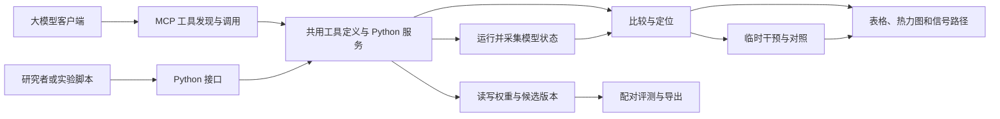

# WSP-toolkit 工具设计

WSP-toolkit 给研究者和大模型提供一套通用的模型检查、解释、干预、编辑与评测工具。**激活**是模型处理输入时产生的中间数值。你可以独立查看激活、比较模型、检验一个部件对输出的影响，也可以进一步修改权重。**权重补丁**是一份可单独保存和重放的权重修改。Qwen 0.6B 和 4B 专业工作流是应用实验。工具接收宿主登记的模型和数据，用户可独立使用其中任意一组能力。

本文与[工具目录](tool-catalog.json)共用工具 ID。第 9 节给出当前实现到路线图的映射。已有能力沿原代码路径接入，新增方法单独登记。以下接口描述目标契约，实际可调用范围由发布版本和后端的能力表决定。研究依据见[工具架构调研](architecture.md)，安装范围见[安装说明](installation.md)，逐项实现和验证见[实现清单与交接](tool-inventory.md)。

- [整体架构](#1-工具怎样组成一次实验) · [共用对象与补丁](#2-全部工具共用的对象) · [基础工具](#3-基础工具)
- [高级分析](#4-高级分析工具) · [高级编辑](#5-高级编辑工具) · [评测与接入](#6-评测与接入工具) · [MCP 与 Python 接口](#mcp-与-python-接口)
- [训练、编辑与部署插件](#7-训练编辑与部署插件) · [三阶段交付](#8-三阶段的交付与实验) · [已有实现与合并路线](#9-已有实现与合并路线) · [可解释性工具实现](#10-可解释性工具实现)

## 1. 工具怎样组成一次实验



| 工具层 | 负责的工作 | 实现位置 |
|---|---|---|
| 基础权重 | 注册模型、读张量、建立补丁和版本 | `tensor_store.py`、`model_registry.py`、`patches.py` |
| 基础运行 | 前向、快照、受限 Python | `hf_backend.py`、`qwen35_backend.py`、`forward_service.py`、`cpu_kernel.py`、`artifacts.py` |
| 高级分析和编辑 | 差分、表示比较、干预、投影、合并、剪枝 | `delta_tools.py`、`comparison_tools.py`、`representation_tools.py`、`intervention_tools.py`、`editing_tools.py`，继续调用原有计算模块 |
| 评测与接入 | 按固定配置评测、公开工具、记录运行与预算 | `evaluation_tools.py`、`protocol.py`、`tool_registry.py`、`mcp_server.py`。MCP 和 Python 共用工具登记表 |

首批通用接口从现有 Qwen3、Llama 和 Qwen3.5 后端接入。**适配器**是一小层代码，把某个模型真实的模块名、张量形状和可观测位置翻译成工具使用的描述。每个模型在 `describe_model` 声明读取权重、前向、记录站点、临时干预、梯度、编辑和导出等能力。分析、绘图、预算和评测使用统一数据格式。新模型按能力注册，具体模型名和专业任务由调用者配置。PyTorch 与 Transformers 提供精细观测，vLLM 的规划用途是加载验证过的检查点做批量评测。两条路径共享版本、输入和运行记录。热更新以后端单独验证为前提。 [NNsight](https://arxiv.org/abs/2407.14561) · [pyvene](https://arxiv.org/abs/2403.07809) · [Transformers 模型接口](https://huggingface.co/docs/transformers/en/main_classes/model) · [vLLM 权重传输](https://docs.vllm.ai/en/latest/training/weight_transfer/)

| 通用性约定 | 实现要求 |
|---|---|
| 同一能力可在不同模型使用 | 调用传入 `variant_id` 和由适配器登记的站点。原始模块名、注意力类型和张量轴由适配器提供。未知站点或不支持的操作在执行前报告具体原因 |
| 支持独立研究任务 | 快照、热力图、概念探针、模型比较、临时干预和评测可以直接对基座运行。没有检查点写权限的会话照样能用已开放的观测工具 |
| 指标与任务可替换 | 用 `MetricSpec` 声明测什么以及怎样对齐输入输出，例如词元分差、分类分数、任务评分。梯度归因只接受能求梯度的分数，完整任务评分可用于独立的对照评测 |
| 支持不同内部结构 | Qwen3 与 Llama 共用生成后端，Qwen3.5 由混合层后端适配。编码器用 `predict` 输出分类分数，复用快照和探针。按后端、模型版本和方法记录实际验证范围 |

模型适配器只处理模型相关的部分。当前观测站点、运行模式和数组轴由后端的 `observation_sites()` 提供，统一服务把这些描述写进快照。例如 `block.4.attention.probs` 只有在模型能提供注意力矩阵时才登记。工具按这些能力和宿主权限开放方法。结构剪枝、量化和稀疏特征字典各自声明额外条件，例如模块形状或字典训练所用的检查点。已经生成的数值文件由通用算法读取，可跨模型后端使用。 [当前后端实现](../src/weight_programming/hf_backend.py) · [NNsight](https://arxiv.org/abs/2407.14561) · [pyvene](https://arxiv.org/abs/2403.07809) · [TransformerLens 模型适配](https://transformerlensorg.github.io/TransformerLens/content/model_tables.html)

```python
class ModelAdapter(Protocol):
    """把具体模型的站点和运行能力接到通用服务。"""
    def describe(self) -> ModelDescription: ...
    def resolve_site(self, site_id: str, operation: str) -> BoundSite: ...
    def run(self, request: ForwardRequest, probes: tuple[BoundProbe, ...]) -> ForwardResult: ...
```

示意中的 `BoundSite` 包含真实模块、输入或输出端口、轴说明和支持的操作。服务先用 `resolve_site` 把观测点落实到模型，再交给后端执行。只分析已保存数组的算法直接读产物，可在没有模型运行进程的机器上重算。

## 2. 全部工具共用的对象

| 对象 | 最小字段 | 代码约定 |
|---|---|---|
| 模型 `ModelRef` | `base_id`、检查点来源和固定版本、架构、文件摘要、分词器与对话模板摘要 | 本地路径和 Hub 名称只用于注册。计算身份时用稳定顺序的文件内容摘要。保留已有 `WeightStore` 身份用于旧实验重放 |
| 模型版本 `VariantRef` | `variant_id`、`base_id`、`parent_variant_id`、`patch_id`、格式 | 每次运行明确传入版本。新版本以父版本和补丁内容生成 ID。父版本可继续单独运行 |
| 张量 `TensorRef` | 完整参数名、形状、原始精度、轴含义、分片、共享权重组 | 轴含义由架构适配器登记。例如普通线性权重是 `[输出通道, 输入通道]`。两个参数名共享同一块权重时，以组为单位写入和验证 |
| 补丁 `PatchRef` | `patch_id`、`base_id`、`parent_variant_id`、修改列表、生成方法、来源产物 ID | 每个条目记录父张量摘要、新张量摘要、形状和原始精度。第一版用 Safetensors 保存完整的替换张量。工具可以接受切片编辑，保存时把切片修改写入一份完整的张量副本 |
| 观测点 `SiteRef` | 逻辑位置、层号、`port`（输入或输出）、轴、适用运行模式 | 例如 `block.12.residual_out` 表示第 12 层输出，`block.12.mlp.down_proj.input` 表示前馈模块下投影的输入。对外 block 从 0 编号。适配旧接口时，第 `n` 层残差输出映射到现有 `hidden_{n+1}`，嵌入映射到 `hidden_0` |
| 快照 `SnapshotRef` | `variant_id`、`run_id`、样本 ID、输入位置或词元 ID、有效位置、站点、轴、`artifact_id` | 词元是模型实际读入的文本片段。位置由适配器解释。生成模型分别标记读完整提示和逐词生成的阶段，分类模型记录编码输入的位置 |
| 指标 `MetricSpec` | `metric_id`、实现版本、目标位置或输出、聚合规则、可微标记 | 干预、归因和评测引用同一个指标。报告记录它所用的对照、分母和样本单位 |
| 解释产物 `EvidenceRef` | `kind`、轴标签、样本 ID、数值或图的引用、来源运行、方法、基线 | 区分原始激活、归因分数、对照效应、表示相似度和回路边。渲染前读数值，图上保留尺度、单位和缺失位置 |
| 运行 `RunRef` | 工具与实现版本、请求摘要、版本、数据划分、后端、种子、状态、用量、产物 | 记录实际执行的前向次数、输入和输出词元、耗时与落盘字节。失败也记录已发生的用量和出错步骤 |

数据由宿主注册，使用 `dataset_id`、`split` 和样本 ID 引用。训练、校准、开发、最终测试分别登记。校准数据用于收集内部统计量。最终测试由宿主持有，程序设计者提交候选后冻结版本，再由宿主评分。大张量、整批输出和逐题明细使用产物 ID，模型调用返回摘要和有限预览。

### 补丁怎样写入和应用

1. `create_patch` 读取指定父版本里的当前值，在独立暂存目录构造修改。输入的替换值、增量和切片坐标分别校验。所有数值转回目标张量的原始精度，再检查有限值和实际变化。小到被舍入的变化会单独计数。
2. 计算所有条目摘要。先写完整 Safetensors 和清单，再在补丁 ID 对应的发布锁内，用同一文件系统的目录重命名发布。读方只查发布目录，暂存区不进入索引。同一补丁并发提交时，后到的调用校验已发布内容后返回同一 ID。任何条目验证失败都报出该张量。
3. `apply_patch` 核对基座、父版本、父张量摘要和共享组，登记候选 `variant_id`。运行时由版本解析器取每个张量最近的替换值，并把这组只读快照交给适配器。HF 工作进程串行绑定快照，退出时恢复参数和移除探针。
4. `revert_patch` 返回登记过的父版本 ID。切换版本只改变下一次调用传入的 ID。重试相同请求返回已有的补丁或运行记录。同一个请求 ID 对应不同输入时直接报错。

`VersionStore` 复用 `WeightStore` 的 Safetensors 索引和编辑校验。补丁完整校验后一次发布。完整模型导出保留原检查点的配置、分词器、生成配置和权重索引，按原精度重写受影响的分片。用新工作目录加载完整导出，核对候选的实际权重和前向读数。 [权重补丁示例](../examples/mcp_patch.py) · [OpenWSP 补丁格式](https://github.com/openwsp/openwsp/blob/8d09276736034f6874bb40e7019247c9541a5551/docs/edit-format.md) · [Safetensors](https://huggingface.co/docs/safetensors/index)

## 3. 基础工具

以下名称用于设计工具契约。输入中的 `artifact_id` 指向已登记的文件或数组，避免模型在调用里拼接几百万个数。

| 工具和依据 | 输入与返回 | 具体实现和验收 |
|---|---|---|
| `register_model`<br>登记检查点。依据 [Hub 按版本下载](https://huggingface.co/docs/huggingface_hub/en/guides/download) 与 [Safetensors](https://huggingface.co/docs/safetensors/index) | 由宿主传本地检查点目录，或 Hub 仓库和完整提交号。返回 `base_id`、初始 `variant_id`、架构与支持状态 | Hub 用 `snapshot_download(revision=...)` 获取固定内容。复用 `WeightStore` 检查文件和分片，登记配置、分词器、权重摘要。普通程序设计者使用已登记模型。验收时重复登记相同内容得到同一 ID，权重或对话模板变更产生不同身份 |
| `describe_model`<br>告诉程序设计者当前模型可操作什么。依据 [OpenWSP MCP](https://github.com/openwsp/openwsp/blob/8d09276736034f6874bb40e7019247c9541a5551/docs/mcp.md) 和 [PyTorch 模块接口](https://docs.pytorch.org/docs/stable/generated/torch.nn.Module.html) | `variant_id`。返回层类型、观测点、上下文限制、可选运行模式、补丁能力和可用后端 | 从注册表读配置，由具体适配器声明功能。混合架构逐层标记普通注意力和其他层。用真模型核对每个公开观测点能抓到声明的形状。读取模型信息时无需运行模型 |
| `list_tensors`<br>查找要修改的参数。依据 [OpenWSP MCP](https://github.com/openwsp/openwsp/blob/8d09276736034f6874bb40e7019247c9541a5551/docs/mcp.md) | `variant_id`、可选模块前缀或层号、分页游标。返回全名、形状、精度、轴、共享组和来源版本 | 复用 Safetensors 索引和已登记的权重元数据，覆盖条目来自补丁清单。按稳定顺序分页，游标绑定版本和筛选。验收全量分页结果与真实索引一致，重复分页顺序一致 |
| `read_tensor`<br>读取一小段权重。依据 [Safetensors 切片接口](https://huggingface.co/docs/safetensors/index) 与 [OpenWSP MCP](https://github.com/openwsp/openwsp/blob/8d09276736034f6874bb40e7019247c9541a5551/docs/mcp.md) | `variant_id`、张量名、各轴的半开区间。返回切片形状、原始精度、来源版本、小预览或 `artifact_id` | 先从版本链确定实际文件，核对范围和字节预算，再用 `safe_open(...).get_slice(name)[...]` 读切片。支持单条目分片读取。验收选一份真实分片权重，切片与全量同区域逐元素一致，并能读到父版本和候选之间的预期差异 |
| `create_patch`<br>保存一组准备应用的修改。依据 [MIT 权重空间编程](https://rikiyat.github.io/blog/weight-space-programming/) 与 [OpenWSP 补丁格式](https://github.com/openwsp/openwsp/blob/8d09276736034f6874bb40e7019247c9541a5551/docs/edit-format.md) | `parent_variant_id`、若干 `replace` 或 `add` 编辑、方法与来源。同一张量的切片需互不重叠。返回 `patch_id`、触及张量、舍入后实际改动数与范数 | 按第 2 节暂存、验证和发布。复用 `EditPolicy` 约束，保留父版本张量原精度及未触及区域。验收在真实模型上提交多张量修改，逐项核对变更。错形状、别名不一致或超预算的请求必须在发布前报错 |
| `apply_patch`<br>登记可运行的候选。依据 [OpenWSP 补丁应用](https://github.com/openwsp/openwsp/blob/8d09276736034f6874bb40e7019247c9541a5551/docs/mcp.md) | `parent_variant_id`、`patch_id`。返回 `variant_id`、父版本、涉及的张量 | 由 `versions.py` 校验父版本及内容，再写候选清单。模型加载时按清单绑定。验收同一请求得到同一候选 ID，指定另一父版本时在运行前报出冲突 |
| `revert_patch`<br>回到父版本。依据 [OpenWSP 权重编辑模型](https://github.com/openwsp/openwsp/blob/8d09276736034f6874bb40e7019247c9541a5551/docs/architecture.md)，父版本返回是本项目的接口设计 | `variant_id`。返回直接父版本 ID。基座无父版本时返回明确错误 | 查版本登记记录。程序设计者把返回值传给 `model_forward` 或 `read_tensor`。验收回到父版本后，张量摘要一致，固定输入输出按同后端预定容差核对 |
| `export_patch` / `import_patch`<br>交换权重修改。依据 [OpenWSP 补丁格式](https://github.com/openwsp/openwsp/blob/8d09276736034f6874bb40e7019247c9541a5551/docs/edit-format.md) | 导出传 `patch_id`，返回清单和权重文件。导入传已登记文件，返回同内容的 `patch_id` 和可应用的父版本 | 用 Safetensors 和带版本号的清单。导入验证格式、文件摘要、父版本和全部条目，验证后走同一发布流程。验收另开真实工作目录，使用同一父检查点导入并逐项核对权重，比较固定输入输出 |
| `export_model`<br>交付完整模型。依据 [Transformers 检查点接口](https://huggingface.co/docs/transformers/en/main_classes/model) | `variant_id`、导出格式。返回检查点路径、导出后基座 ID 和格式 | 按候选版本解析权重，使用 Safetensors 重写受影响的分片。分词器、配置和模板随检查点复制。用新工作目录重新加载，核对权重和固定前向结果。vLLM 的兼容性单独验证 |
| `model_forward`<br>让目标模型处理输入。依据 [MIT 实验 8 工具协议](https://github.com/RikiyaT/lm_understand-logs/blob/main/exp8_math/runs/p50c/turns/t001/prompt.txt) 与 [OpenWSP 前向接口](https://github.com/openwsp/openwsp/blob/8d09276736034f6874bb40e7019247c9541a5551/docs/mcp.md) | `variant_id`、输入、模式、预算与可选观测。保留 `generate` 生成和 `teacher_forced` 给定序列评分。`predict` 已支持 DistilBERT 单标签分类分数。只传当前模式所需设置 | 复用 `ForwardService` 和 `BudgetLedger`，把现有 `original` 或 `edited` 绑定改接版本解析器。适配器声明输入类型、模式、输出轴和能否采集各类站点。验收真实生成模型的词元、分数和用量，并对照分类模型直接推理结果 |
| `read_artifact`<br>读快照、矩阵或逐题结果。依据 [OpenWSP 受限读取](https://github.com/openwsp/openwsp/blob/8d09276736034f6874bb40e7019247c9541a5551/docs/mcp.md) | `artifact_id`、数组键或记录筛选、切片或页长。返回小数据、类型、轴和来源 `run_id` | `artifacts.py` 按登记格式用成熟库读取，校验归属、字节、坐标和数据访问权限。验收同一快照的完整汇总与切片重算一致，最终测试逐题标签只向宿主开放 |
| `execute_python`<br>让程序设计者写自己的分析。依据 [MIT 原作](https://rikiyat.github.io/blog/weight-space-programming/) 和 [OpenWSP Python 内核](https://github.com/openwsp/openwsp/blob/8d09276736034f6874bb40e7019247c9541a5551/docs/architecture.md) | `session_id`、`variant_id`、`code`、可选的 `input_artifacts`、`outputs` 和 `edits`。返回有限文本、运行 ID、数组和补丁 ID | 复用 `CPUKernel` 的 Linux 隔离进程。宿主为会话挂载固定的权重版本，按请求提供只读数组。Python 中用 `load`、`read_array`、`save_array` 读写分析数据。宿主用 `VersionStore.create_patch` 校验提案。已用真实权重切片验证变量跨调用保留、快照可读和候选可重放 |

`model_forward` 的观测选项接收站点、输入位置或生成步、切片或聚合方式，返回快照 ID、形状与统计。复用 PyTorch 观测函数和已有后端记录嵌入、残差、前馈输入及受支持的注意力矩阵。残差是逐层传递的主状态。给定文本的分数和快照可以同次前向采集。现有生成路径用采样后重放获取激活摘要，单独记采集方式和用量。验收按站点检查形状、有效词元、开启观测前后的输出与清理情况。注意力头输出、键值缓存、专家路由和梯度分别登记，并用真模型验证。 [NNsight](https://arxiv.org/abs/2407.14561) · [pyvene](https://arxiv.org/abs/2403.07809)

### 一个切片补丁请求

```json
{
  "parent_variant_id": "var_parent",
  "edits": [
    {
      "tensor": "model.layers.12.mlp.down_proj.weight",
      "op": "add",
      "region": [[0, 16], [32, 40]],
      "value_artifact_id": "art_delta_16x8"
    }
  ],
  "method": "custom_python"
}
```

这条请求表示在父版本的目标矩阵里，把一个 `16 × 8` 的数组加到第 0 至 15 行、第 32 至 39 列。`region` 省略时表示整个张量。`value_artifact_id` 可来自 `execute_python` 或高级配方。服务返回 `patch_id` 和写回原始精度后的变化。下一次调用 `apply_patch` 时明确传入这次的父版本和补丁 ID。

### 代码示意：权重修改怎样保留实际精度

```python
import torch


def build_replacement(parent, region, delta):
    """为已验证的浮点切片生成一份完整的替换张量。"""
    replacement = parent.clone()
    # 在 FP32 中计算，再写回检查点的原始精度。
    updated = parent[region].float() + delta.float()
    replacement[region] = updated.to(parent.dtype)
    if not torch.isfinite(replacement[region]).all():
        raise ValueError("修改写回原始精度后出现非有限值")
    # 报告保存后真正发生的改动，小于舍入精度的增量可能被吞掉。
    realized_delta = replacement[region].float() - parent[region].float()
    return replacement, realized_delta
```

这段示意适用于第一版支持的 FP16、BF16 和 FP32 浮点张量。输入形状、权限和预算由服务层在调用前检查。切片的每个轴都需要合法范围，输入数组形状必须精确匹配。复制父张量后再改切片，能把同一张量的其他位置原样保留下来，也让程序设计者看到保存后究竟改动了多少。

### 代码示意：记录指定词元的层输入

```python
from contextlib import contextmanager


@contextmanager
def capture_linear_input(module, token_positions, observations):
    """记录一次整段前向中指定位置的线性层输入。"""
    def observe(_module, args):
        # 线性层的输入形状是 [样本, 词元, 通道]，先切片再转存。
        values = args[0][:, token_positions, :].detach().cpu()
        observations.append(values.clone())

    handle = module.register_forward_pre_hook(observe)
    try:
        yield
    finally:
        handle.remove()
```

这段函数覆盖同一批样本共享位置的整段前向。正式接口先由适配器把逻辑站点解析到真实模块，确认词元位置有效，再在 `backend.activate(snapshot)` 的范围内挂上观测。逐词生成按生成步记录当次输入以及它的全局词元位置。两个进程里的观测结果以模型版本和站点 ID 归档。 [PyTorch 前向观测接口](https://docs.pytorch.org/docs/stable/generated/torch.nn.Module.html)

## 4. 高级分析工具

分析工具给出能继续验证的结果。每份报告都记录所用版本、样本、对应位置和计算方法。程序设计者可以把其中的方向或样本编号直接传给下一项工具。

| 工具和依据 | 输入与返回 | 具体实现和验收 |
|---|---|---|
| `analyze_weight_delta`<br>解释微调或编辑改了哪里。依据 [Task Arithmetic 任务向量](https://arxiv.org/abs/2212.04089)、[LoRA](https://arxiv.org/abs/2106.09685) 和 [OpenWSP 方向分析](https://github.com/openwsp/openwsp/blob/8d09276736034f6874bb40e7019247c9541a5551/src/openwsp/inspection.py) | `base_variant_id`、候选版本或已登记的 PEFT 适配器、张量选择、可选第二候选及输入快照。返回逐层变化、改变的元素与列、主要方向、方向相似度和局部输出影响 | 在同一参数坐标按层读 `W₁−W₀`，累积平方和、变化数和点积。复用 `compare_edits` 与 `src/analyze_delta.py` 的已有分析。适配器通过 PEFT 解析到同坐标，标准线性 LoRA 为 `scale × (B @ A)`，记下实际每层比例与转置规则。验收比较真实适配器的理论增量、合并后的原精度增量、实际前向，分别报告 |
| `compare_models`<br>比较两个模型的权重、内部表示和结果。依据 [CKA 表示相似度](https://proceedings.mlr.press/v97/kornblith19a.html) 与 [Git Re-Basin 神经元对齐](https://arxiv.org/abs/2209.04836) | 两个 `variant_id`、公共样本、`views`、站点与样本对齐方式。返回比较类型、权重几何、层间相似度或逐题行为差异 | 权重路线调用 `analyze_weight_delta` 或使用已验证的参数对齐方案。表示路线发出两次 `model_forward` 的观测请求，按同一批样本对齐，用中心化线性 CKA 算层间矩阵。行为路线调用 `evaluate_variants`。验收真实模型自比在有方差的站点接近 1，改变样本排列会改变比较，缺少参数对应时拒绝权重路线 |
| `score_preferences`<br>检查修改后对更优回答的相对倾向。依据 [DPO 偏好优化](https://arxiv.org/abs/2305.18290) 的相对对数概率 | 候选与参考版本、偏好对 ID、分数聚合方式。返回每对答案分差、相对参考的变化、词元长度和汇总 | 对同一提示的优选和次选回答分别做 `teacher_forced`。只累加回答词元的对数概率，计算 `候选分差 − 参考分差`。DPO 对照用序列求和，同时可以单列按词元平均的诊断。复用前向工具，验收从真实生成或标注偏好对手算核对几条，并用任务评分验证是否有行为收益 |
| `run_intervention`<br>临时替换或屏蔽某处激活来检验其影响。依据 [激活替换方法研究](https://arxiv.org/abs/2309.16042) 与 [pyvene](https://arxiv.org/abs/2403.07809) | 一个版本、干净与受扰样本、观测点、词元位置、通道、干预类型、指标。返回基线、受扰、干预及差值，附快照或逐题记录 | 复用 `ActivationPatchingStudy.run` 的三组运行和 `replace_activation` 的短期观测函数。首版替换支持真实模型上已验证的同长度输入和明确位置，可新增独立的 `zero` 屏蔽执行路径。每次退出移除观测函数。验收记录三组前向，恢复后固定输入与干预前一致，原权重摘要一致 |
| `localize_behavior`<br>在多个部件中寻找行为候选。依据 [激活替换方法研究](https://arxiv.org/abs/2309.16042) 与 [AtP* 梯度近似](https://arxiv.org/abs/2403.00745) | 候选站点、样本分组、目标指标、每轮预算、复核样本。返回干预效应排序、失败样本和每项运行记录 | 在每个样本上复用干净和受扰前向与所需快照，随后按站点运行确切干预。对比同规模的随机位置或自替换。发现集排序、独立开发集复核，按题汇总效应。梯度插件可在单独授权的配置下做预排序，入选站点仍执行确切干预。验收报告候选的支持样本数、效应方向、用量与复核结果 |

### 微调差分怎样算

1. **找对应关系。** 检查基座、模型架构、张量名、形状和轴。直接比较要求两个检查点有明确的共同参数坐标。独立训练的模型即使形状相同，也可能用了不同的内部坐标。两个检查点有经验证的对齐映射时，记录映射版本和验证结果。
2. **先读统计，再挑矩阵。** 按层或块计算实际改动元素数、绝对大小、相对大小和变化方向。相对大小是 `||ΔW|| / ||W₀||`，分母为零时返回未定义原因。两个更新在同一坐标用带符号余弦比较，正值代表方向相近。为选中矩阵做 SVD（把大矩阵拆出几个主要变化方向）。小矩阵用 `torch.linalg.svd`，大矩阵用有种子和预算的近似方法，注明保留方向数与重建误差。 [OpenWSP 方向分析](https://github.com/openwsp/openwsp/blob/8d09276736034f6874bb40e7019247c9541a5551/src/openwsp/inspection.py)
3. **区分两种增量。** 标准 LoRA 用低秩矩阵表示更新，`scale` 由所用配置决定，支持范围内优先复用 PEFT 模块的有效更新和合并语义。保留计算精度下的理论更新与合并到检查点后可读取的真实更新。对 DoRA 等带额外变换的适配器，按该版本 PEFT 的实际合并结果取差分，未通过验证的类型直接报出。 [PEFT 权重格式](https://huggingface.co/docs/peft/en/developer_guides/checkpoint) · [PEFT LoRA 接口](https://huggingface.co/docs/peft/en/package_reference/lora)
4. **看更新如何作用到输入。** 取该线性层在父版本上的输入 `X[词元, 输入通道]`，计算 `X @ ΔW.T`。它回答「这批词元经过这个层时，光看这次权重改动，会让该层输出变多少」。若也改了偏置，另加偏置差。随后用整模型前向比较输出，把局部效果和端到端结果分别记录。

### 两个模型怎样对齐观测

| 关系 | 实际比较方法 |
|---|---|
| 同基座或经核对的共同坐标 | 比较同名权重、同批输入上的表示、行为结果。可进一步比较两个候选各自的更新方向 |
| 独立训练但有已验证的参数映射 | 把声明支持的张量映射到公共坐标，再计算几何指标。其他部分用共同输入比较表示和任务表现 |
| 架构或分词器不同 | 用同一批题和语义位置比较。例如用每道题的完整提示末端作为公共锚点。激活可有不同宽度。词元级分数只在词元及其概率事件已对齐时直接比较，跨模型结果用相同任务评分 |

线性 CKA 的核心代码如下。输入的行已经按同一样本和观测位置对齐，列是各模型自己的通道。对每组列减均值后，计算样本之间的相似矩阵，再看两张矩阵有多接近。中心化以后某模型的样本全一样时，返回该站点分数未定义。

```python
def linear_cka(x, y):
    """比较同一批样本在两个站点的表示。"""
    if x.ndim != 2 or y.ndim != 2 or x.shape[0] != y.shape[0] or x.shape[0] < 2:
        raise ValueError("需要至少两行已对齐的样本")
    x, y = x.double(), y.double()
    x, y = x - x.mean(0), y - y.mean(0)
    left, right = x @ x.T, y @ y.T
    denominator = left.norm() * right.norm()
    if denominator.item() == 0:
        return None
    return ((left * right).sum() / denominator).item()
```

工具会在调用前检查有限值和对齐表，并按样本数估算矩阵内存。样本太多时用明确登记的分批算法或预先声明的样本子集。报告记录样本 ID、算法、样本数和聚合规则，方便重新计算。 [CKA 论文](https://proceedings.mlr.press/v97/kornblith19a.html)

### 一次干预怎样判断

用同一目标指标跑三组。举例说，指标可以是正确答案词元相对干扰答案词元的分数差。先跑原输入得到 `clean`，再跑改坏关键信息的输入得到 `corrupt`，最后在受扰输入的指定位置用原激活替换得到 `patched`。报告 `patched−corrupt`，并在 `clean−corrupt` 达到事先声明的最小幅度时报告恢复比例。逐题保留两种指标。能恢复某一指标说明所选部件在这组输入和干预条件下对它有影响。构造永久权重补丁后，另用完整生成和独立题目检查。 [激活替换指标与扰动选择](https://arxiv.org/abs/2309.16042) · [真实配对激活干预记录](../research/reports/activation-patching-study.md)

## 5. 高级编辑工具

这些工具生成候选补丁。对于维度不变的修改，统一调用 `create_patch` 保存，再由程序设计者用 `apply_patch` 选择要运行的候选。结构剪枝或量化会改变检查点结构或表示，使用独立导出的模型版本，附上原始模型和生成方法。

| 工具和依据 | 输入与返回 | 具体实现和验收 |
|---|---|---|
| `project_weight`<br>沿选定方向改变一个线性层。依据 [MIT 权重空间编程](https://rikiyat.github.io/blog/weight-space-programming/) 与 [Arditi 等的方向去除](https://arxiv.org/abs/2406.11717) | 父版本、目标矩阵、同输出坐标的方向、列范围、强度。方向可由两组对齐激活构造。返回补丁、改动范数和列范围 | 复用 `contrast_direction` 得单位方向 `u`，再用 `project_output_direction` 执行 `W[:, C] − strength × u × (uᵀW[:, C])`。先核对观测站点的通道与目标输出坐标。验收强度为 1 时所选列沿 `u` 的分量接近零，其余列保持原值。实际效果用强度扫描与同范数方向对照 |
| `merge_updates`<br>把多个已有更新合成一个。依据 [Task Arithmetic](https://arxiv.org/abs/2212.04089) 与 [TIES](https://arxiv.org/abs/2306.01708) | 同一父版本的更新 ID、方法、系数或保留比例、可选范数约束。返回补丁、输入与合并后的范数、保留比例和符号冲突统计 | 读有效增量。加权方式逐张量计算 `Σ αᵢΔWᵢ`。TIES 裁掉小变化、在相冲突的符号里选方向，再聚合一致的更新。复用 `ties_merge`，记清裁剪范围和实现变体。验收真实两份更新的结果可重算，比较单独应用、加权和同范数 TIES |
| `prune_and_compensate`<br>删除权重并可选地补偿误差。依据 [Wanda](https://arxiv.org/abs/2306.11695) 和 [SparseGPT](https://arxiv.org/abs/2301.00774) | 父版本、线性层、校准集、方法和稀疏度。固定掩码补偿另传布尔数组，`true` 表示删除。返回补丁、掩码、真实零值比例、局部重建误差 | 用 `model_forward` 的观测模式取有效输入行。Wanda 复用 `src/paper_methods.py` 的 `wanda_mask`，按行用 `abs(W) × sqrt(sum(X²))` 排序。SparseGPT 复用 `input_hessian` 和 `sparsegpt_reconstruct`，用输入之间的联合变化指导剩余权重补偿。验收比较同一批真实层输入上的原始值、单纯剪枝和固定掩码补偿，并另测开发集任务结果 |
| `compress_update`<br>用更少的参数保存已有角色更新。依据 [LoRA 低秩更新](https://arxiv.org/abs/2106.09685) 和 [低秩模型压缩研究](https://arxiv.org/abs/2403.07378) | 既有低秩更新、按层的秩预算、可选校准输入。返回小型更新文件、实际参数数、重建误差，可另登记成权重补丁 | 复用 `src/delta_programming.py` 的 `truncate(A, B, rank)` 和 `weighted_truncate(A, B, C, rank)`。输入加权时先算 `Z = X @ A.T`，再用 `C = Z.T @ Z / n` 保存低秩空间的输入统计。用真实更新核对目标秩、体积、`X @ ΔW.T` 的误差、角色效果及适配器加载。合并成密集权重后，单独记录部署体积 |

### 剪枝实现要区分两项研究问题

- **删哪些。** 收集父版本在角色或任务校准样本上的真实输入，排除填充词元。Wanda 在每个输出通道内选低分权重。统一记录每层目标比例、原来已有的零值、实际删除数和计算预算。以按权重绝对值删除作为简单对照。 [Wanda](https://arxiv.org/abs/2306.11695)
- **删完怎样补偿。** 用同一掩码对比直接置零和 SparseGPT 补偿，隔离掩码选择的影响。现有 `input_hessian` 计算 `2 XᵀX / n`，记录有效词元数、阻尼、分块大小和候选。仓库中的局部实现支持固定掩码与自适应块选择，方法记录标明所用变体。验收同时记录校准输入和保留输入上的 `||X(W_new−W_old)ᵀ||²`。宽层运行前检查二阶矩阵的内存需求。 [SparseGPT](https://arxiv.org/abs/2301.00774) · [现有重建实验](../research/reports/reconstruction-study.md)

`prune_and_compensate` 第一版生成的补丁仍保持原矩阵形状。要证明效率收益，需要导出对应的稀疏内核、量化格式或结构更小的模型，并在指定后端量延迟、吞吐和显存。

### 后训练方法怎样进入工具包

| 经典方法 | 工具如何借用 | 研究对照 |
|---|---|---|
| 监督微调与 LoRA | 将真实训练前后的更新交给 `analyze_weight_delta`，抽取层级变化、有效秩和对角色输入的影响。供 `merge_updates` 和 `compress_update` 使用 | 同数据下的普通角色 LoRA，训练步数、可训练参数和计算成本单列。 [LoRA](https://arxiv.org/abs/2106.09685) |
| DPO 偏好优化 | `score_preferences` 复用候选相对于参考的偏好分差。该工具只做评分，训练由单独授权的后端运行 | 在真实偏好对上比较普通 DPO 与程序化编辑，另看独立任务表现。 [DPO](https://arxiv.org/abs/2305.18290) |
| 教师到学生蒸馏 | 让大模型的角色决策、工具调用和交接输出成为 4B 模型的可训练数据。以真实蒸馏产生的权重更新作为分析输入 | 同数据、同基座比较角色蒸馏、普通监督更新和权重程序编辑，分别记录训练与搜索花费。 [知识蒸馏](https://arxiv.org/abs/1503.02531) · [角色编程实验协议](../research/protocols/multiagent-role-programming.md) |

### 代码示意：固定同一个掩码比较剪枝补偿

```python
from paper_methods import wanda_mask
from weight_programming.reconstruction import input_hessian, sparsegpt_reconstruct


def build_pruning_pair(weight, valid_inputs, fraction):
    """用同一批输入和同一掩码构造两个候选。"""
    # valid_inputs 是运行真模型时记录的层输入，已排除填充词元。
    energy = valid_inputs.double().square().sum(0)
    mask = wanda_mask(weight.double(), energy, fraction)
    # 两条路径都清零校准输入能量为零的列。
    mask[:, energy.eq(0)] = True
    pruned = weight.masked_fill(mask, 0)
    repaired, _, details = sparsegpt_reconstruct(
        weight, input_hessian(valid_inputs), prune_mask=mask
    )
    return pruned, repaired, mask, details
```

两个候选使用同一份目标删除掩码。第一个直接置零，第二个调整剩余权重来补偿。现有 SparseGPT 原语还会将校准集中输入能量为零的列置零。正式比较时，两条路径都先把这些列合入固定删除条件，分别记录目标掩码、零能量列和保存后实际零值。服务层把两个候选分别写成补丁，在未参与构造的样本上比较，以分开估计补偿和删除位置的影响。

## 6. 评测与接入工具

| 工具和依据 | 输入与返回 | 具体实现和验收 |
|---|---|---|
| `evaluate_variants`<br>在同一批任务上比较原始和候选。依据 [LM Evaluation Harness](https://github.com/EleutherAI/lm-evaluation-harness) 与[本项目配对评测](../research/reports/math500-evaluation.md) | 基线 ID、候选 ID、数据划分、评分配置、后端、生成配置、预算。返回逐题产物、汇总、差值、置信区间和成本 | `evaluation.py` 保留现有生成与评分路径，新增版本绑定和通用评分接口。每个候选共享案例、提示、种子方案和上限。按 `case_id` 与重复样本编号连接结果，按案例聚类做配对重采样。预热和正式计时分开记录。验收用真实公开任务核对计数、停止原因、正确率和成本，从落盘明细重算汇总 |
| `list_tools`<br>列出当前能用的工具。依据 [MCP 工具发现规范](https://modelcontextprotocol.io/specification/2026-07-28/server/tools) 与 [OpenWSP 工具列表](https://github.com/openwsp/openwsp/blob/8d09276736034f6874bb40e7019247c9541a5551/docs/mcp.md) | Python 使用当前配置和可选的 `variant_id` 查询工具、方法、版本、参数和前置条件。MCP 客户端通过原生 `tools/list` 查询 | `tool_registry.py` 以同一份登记信息提供两边的发现结果。按实际实现和授权筛选工具，适配器通过 `describe_model` 报告具体模型的能力。验收发现结果与调用权限一致 |
| `get_run`<br>查看一项分析或评测的状态。依据仓库的 [前向预算日志设计](../research/reports/forward-service.md)，通用记录结构由本项目定义 | `run_id`。返回运行状态、完成步骤、预算用量、产物 ID，失败时带错误代码和具体位置 | 将 `BudgetLedger` 的开始和结束记录与产物清单关联。以追加记录存进度，最终写完成或失败状态。耗时分析可以由单个工作进程后台执行。验收实际运行从登记到完成可查询，进程中断后可识别未完成记录，并且只读取已发布产物 |

### MCP 与 Python 接口

**MCP（模型上下文协议）是 WSP-toolkit 面向大模型客户端的标准接口。Python 是实际计算和研究者直接调用的接口。两边共用一份工具定义和同一套 Python 实现。** 研究者在脚本或笔记本中可以直接使用 Python。大模型客户端通过 `tools/list` 发现工具，再通过 `tools/call` 调用。本地服务默认只读，宿主可以单独授权权重编辑和激活干预。 [安装与用法](installation.md#本地-mcp-与-python-只读工具) · [MCP 工具规范](https://modelcontextprotocol.io/specification/2026-07-28/server/tools)

| 层 | 职责 |
|---|---|
| 工具登记表 | 每个工具只登记一次，记录名称、版本、输入和输出格式、权限、需要的模型能力及 Python 执行函数。现有 `execute_python` 和 `model_forward` 的定义与分发逻辑是接入起点 |
| MCP 适配层 | 从登记表提供工具发现和结构化结果。把调用参数交给共用服务，按协议返回成功或失败。按客户端需要附简短文本或可读资源链接 |
| Python 服务 | 校验输入、权限、模型能力与预算，执行同一个函数，记录运行和产物。Python 接口直接调用这层。给已加载张量做计算的函数继续接受张量对象，便于在研究脚本里复用 |

**结果按大小返回。** 小结果返回结构化摘要。激活快照、热力图和权重补丁保存在产物服务，MCP 返回产物 ID、类型、形状或轴说明，必要时附有限预览。用 `read_artifact` 按层、词元或切片取数。耗时任务先返回 `run_id`，用 `get_run` 查询进度和最终产物。运行、产物和工作区由显式 ID 引用。 [MCP 工具结果](https://modelcontextprotocol.io/specification/2026-07-28/server/tools#tool-result)

**默认只开放观测。** 服务根据权限筛选可发现的工具，并在实际调用时检查权限、模型能力与产物归属。临时干预、权重写入和 `execute_python` 各自需要显式授权。MCP 和 Python 经过同一套校验，原作复现配置保留既有工具参数及实验权限。

**第一版验证顺序。** 用真实模型依次调用 `describe_model → model_forward → read_artifact`，发现可观测层、采集一次激活、按需取一个切片。用 Python 和 MCP 各跑一遍同配置请求，核对站点、形状和数值。再检查只读配置发现的工具与可调用权限一致。该链路接通后，沿同一个入口接入补丁、剪枝和评测。 [现有工具分发源码](../src/weight_programming/tool_api.py)

### 模型收到的工具结果

下面是 `analyze_weight_delta` 的示意结果，ID 和数字仅用于展示字段。

```json
{
  "run_id": "run_delta_001",
  "status": "succeeded",
  "summary": {
    "scope": "same_weight_coordinates",
    "changed_tensors": 4,
    "top_tensor": "model.layers.12.mlp.down_proj.weight"
  },
  "artifacts": {"tensor_report": "art_delta_table", "top_directions": "art_delta_svd"},
  "usage": {"model_forwards": 0, "elapsed_ms": 156}
}
```

程序设计者可以用 `read_artifact` 查看某一层的变化，再选一个有明确坐标的方向传给 `project_weight`。失败时返回结构化错误，例如 `UNSUPPORTED_SITE`、`BUDGET_EXCEEDED`、`PARENT_MISMATCH`，以及受影响的版本或站点。执行服务在问题出现处结束此次调用，记录已使用资源。长任务可以先返回 `run_id`，通过 `get_run` 取得结果。运行记录包含工具版本、数据和后端配置，重放时使用这些固定输入重新调用。

原作复现配置沿用 `tool_api.py` 的两个入口及原参数。通用研究配置默认开放读取、快照和只读分析，按实验需要授权干预、编辑或开发集评测。训练和部署插件各自声明所需计算权限。最终测试、检查点注册与向外发布由宿主执行。

### 服务层怎样调用高级工具

以剪枝配方为例，`recipes.py` 从版本读取目标权重，向观测服务请求校准数据的层输入，然后调用纯张量函数。最后把候选写进补丁服务。计算函数可以独立在 Python 中调用。调用者通过 MCP 运行时，执行的仍是同一个函数。

```python
def build_layer_pruning_candidates(services, request):
    """生成直接剪枝与补偿两个候选。示意新增服务的调用关系。"""
    parent = request.parent_variant_id
    weight = services.versions.read_native(parent, request.tensor_name)
    # 适配器从目标权重推导对应的输入站点，检查两边通道坐标。
    site = services.models.linear_input_site(parent, request.tensor_name)
    snapshot = services.observations.capture(parent, site, request.calibration)
    inputs = services.artifacts.read_valid_input_rows(snapshot)

    pruned, repaired, mask, details = build_pruning_pair(weight, inputs, request.fraction)
    mask_id = services.artifacts.save_array(mask)
    candidates = {}
    for method, value in (("wanda", pruned), ("wanda_sparsegpt", repaired)):
        candidates[method] = services.versions.create_patch(
            parent_variant_id=parent,
            replacements={request.tensor_name: value},
            method=method,
            source_artifacts=[snapshot.artifact_id, mask_id],
        )
    return {"candidates": candidates, "mask_id": mask_id, "reconstruction": details}
```

`read_native` 和 `read_valid_input_rows` 是内部调用，按工具登记的预算读取整块数据。给模型的公开 `read_tensor` 和 `read_artifact` 仍使用切片或有限预览。配方输出候选和构造证据，模型选择候选后再调用 `apply_patch` 和 `evaluate_variants`。如果配方在构造第二份补丁时失败，运行记录会标明已发布的第一份补丁，重试时按内容 ID 复用它。

## 7. 训练、编辑与部署插件

插件实现和真模型验收完成后，再加入 `list_tools`。每个插件复用已有的版本、产物和评测接口，调用者可以沿同一流程追溯结果。

| 计划工具 | 输入、产出与代码实现 | 验收 |
|---|---|---|
| `edit_facts`<br>编辑单条或多条事实。依据 [ROME](https://arxiv.org/abs/2202.05262)、[MEMIT](https://arxiv.org/abs/2210.07229)、[EasyEdit](https://aclanthology.org/2024.acl-demos.9/) | 传父版本、方法、层、校准文本和事实列表。每条事实含 `subject`（主体）、`prompt`（有一个 `{}` 的句式）、`target_true`（原答案）、`target_new`（目标答案）。返回补丁和报告 ID | 从真实前馈输入计算通道共同变化的二阶统计，交给独立环境中的 EasyEdit。只接收所选层的前馈输出权重，复用补丁格式。应用补丁后用 `score_preferences` 分别测直接问题、同义改写和邻近事实 |
| `compress_model`<br>导出可部署的较小模型。依据 [LLM-Pruner](https://arxiv.org/abs/2305.11627)、[ShortGPT](https://arxiv.org/abs/2403.03853)、[SliceGPT](https://arxiv.org/abs/2401.15024)、[GPTQ](https://arxiv.org/abs/2210.17323)、[AWQ](https://arxiv.org/abs/2306.00978) | 输入版本、方法、校准文本或登记样本，以及目标层数、通道比例、隐藏宽度或量化分组。输出检查点目录、格式、参数量和权重字节。删层、通道剪枝、隐藏维度切片和 4 位打包均走同一发布清单 | 已在真实模型重载五种产物。SliceGPT 需按切片配置恢复跳连矩阵。GPTQ 和 AWQ 使用 [LLM Compressor](https://github.com/vllm-project/llm-compressor) 的 `compressed-tensors` 格式。速度、显存和任务表现分别测量 |
| `train_update`<br>产生可比较的任务训练更新。依据 [LoRA](https://arxiv.org/abs/2106.09685)、[DPO](https://arxiv.org/abs/2305.18290) 与 [序列蒸馏](https://aclanthology.org/D16-1139/) | 接收父版本、训练集 ID、样本、模块名及训练方法。在独立模型实例上用 PEFT 训练。产出标准适配器和同坐标更新因子，按需生成权重补丁。清单保存数据摘要、训练设置、损失和词元用量 | 已用真实样本各跑一步，并核对原生适配器与通用更新因子。模型能力另用独立任务评测 |
| `merge_updates` 的 `dare` 方法<br>保留部分更新再重缩放。依据 [DARE](https://arxiv.org/abs/2311.03099) 与 [MergeKit](https://aclanthology.org/2024.emnlp-industry.36/) | 接收 `drop_probability`、`seed` 和可选的 `dare_merge`。按保留概率抽掩码，保留的增量除以该概率，再走加权合并或 TIES 符号合并。返回每个更新的实际保留率与种子 | 固定种子在真实补丁上重放，核对输出补丁和缩放。模型表现用独立任务比较 |

## 8. 三阶段的交付与实验

### 第一阶段：把工具包开源到可以接手开发和使用

1. **通用基础。** 先接通 [MCP 与 Python 共用的只读链路](#mcp-与-python-接口)。在真实 Qwen3 与 Llama 上复用运行、权重读取和临时干预请求，验证 Qwen3.5 混合层的能力发现。随后接通补丁登记、导入、导出和重放。公开只读解释与权重编辑两条示例。
2. **归并已有能力。** 在 `model_forward`、`execute_python` 上接入通用站点与版本，补 `read_artifact`、`get_run`。把投影、差分、局部干预、扫描、图表、TIES、Wanda 和 SparseGPT 接入公共入口，沿用原计算实现。发布支持矩阵、接口与来源说明。
3. **补上解释工具。** 按第 9 节顺序接入概念探针、表示比较、词元归因和层级读出。以额外的真实编码器验证通用快照、概念探针和分类分数。特征字典与回路方法按能力分别发布。 [现有发布记录](../research/reports/open-source-release.md) · [安装与架构支持](installation.md)

### 第二阶段：在 0.6B 上验证模型编程效果

使用一项可重复评分的真实任务。程序设计者先在开发集找一类具体失败，用 `model_forward` 的观测模式与 `localize_behavior` 提候选位置。再用 `project_weight`、`merge_updates` 或 `prune_and_compensate` 构造候选，用 `analyze_weight_delta` 解释改动，最后交宿主跑原始与候选配对评测。构造前登记小规模预实验，检查输入、输出、站点、实际权重与评分，再扩大运行。

正式对照包括原模型、固定文献配方、同预算简单搜索和大模型调用工具。涉及训练更新时，增加普通 LoRA 对照。除总分之外，报告逐题改善与退化、任务失败类型、工具消融、构造用量和部署成本。权重改变、内部干预和任务结果通过产物 ID 串联。 [三阶段路线](../research/roadmap.md) · [既有剪枝和补偿结果](../research/reports/reconstruction-study.md)

### 第三阶段：在 4B 专业工作流中替换角色

1. **先验证协作收益。** 选 OfficeBench 的跨应用任务，或 Finch 的财会任务。法律任务按现有协议选择可复现的基准。用同样的模型版本、工具权限、任务和预算比较单 Agent 与多 Agent。记录任务成功率、失败位置、每个角色的调用次数与成本。按预先登记的质量和成本门槛选出后续要研究的工作流。 [专业工作流评测协议](../research/protocols/professional-workflow-protocol.md)
2. **把角色转成可评测对象。** 从胜出的多 Agent 工作流记录角色输入、可用动作、交接格式、下游状态与评分。按案例划分，避免同一案例的不同步骤跨到训练和最终评测。普通角色 LoRA 或蒸馏提供可比较的 4B 更新。程序设计者用差分、快照、因果定位和剪枝工具，对角色目标提出自己的 4B 候选。
3. **替换后跑完整任务。** 固定编排、角色提示、权限和输入。先一次只替换一个角色，再联合替换。用原始 4B 角色、标准训练角色和权重编程角色比较。分别记录角色动作准确性、交接成功、最终任务质量和端到端延迟。若做压缩，预先定义可接受的角色与系统质量差，报告吞吐、显存、冷启动与常驻资源。 [多 Agent 角色编程协议](../research/protocols/multiagent-role-programming.md) · [OfficeBench 执行方案](../research/protocols/officebench-workflow-experiment.md)

最后保存三份可以独立复查的结果。第一份是协作是否带来收益的配对数据。第二份是每个角色的父模型、权重补丁、编程过程和单角色得分。第三份是替换整个系统后的任务表现和资源账单。由此可以分别验证协作价值、权重编程增益和部署效率。

## 9. 已有实现与合并路线

**已公开入口**表示现有分发器可以直接调用。**复用并封装**表示算法或实验脚本已存在，建设项是统一输入、输出、权限或适配。**补齐方法**表示公共入口会复用现有服务并加上新的计算方法。**新增方法**表示核心算法还待接入或实现。每个能力只有一个工具归属。新增一种算法通过 `method` 参数或适配器能力登记。机器可读的同一清单见[工具目录](tool-catalog.json)。

| 顺序 | 工具 ID | 已实现与下一步 |
|---|---|---|
| 1 · 通用基础 | `execute_python`、`model_forward` | **已接入。** 前向继续共用 `ForwardService`。宿主可单独授权隔离 Python，会话绑定一个模型版本，可交换登记的数组并提交补丁。两项工具共用 MCP 和 Python 登记表 |
| 1 · 通用基础 | `register_model`、`describe_model`、`list_tensors`、`read_tensor` | **已接入基座和候选。** 宿主登记检查点后可查询能力、列张量和读原精度切片。返回张量实际来源版本 |
| 1 · 通用基础 | `create_patch`、`apply_patch`、`revert_patch`、`export_patch`、`import_patch`、`export_model` | **已接入。** 编辑授权后可创建、应用、撤销、交换补丁并导出完整检查点。真实模型已验证候选前向、跨工作区重放和完整检查点重载 |
| 1 · 通用基础 | `read_artifact`、`get_run`、`list_tools` | **已接入。** 读取前向与干预的数值、生成记录和图表信息，查询运行账本。Python 与 MCP 原生发现共用登记表 |
| 1 · 观测与干预 | `run_intervention`、`localize_behavior` | **已接入。** 激活替换、置零消融、方向注入和 LEACE 复用 `patching.py`。AtP* 用 GradDrop 筛选残差和前馈输入站点，再复用精确扫描验证入选项 |
| 1 · 观测与干预 | `render_evidence` | **已接入五类热力图和有向图。** 注意力最大流、路径替换、ACDC 和 EAP 共用同一节点与边格式，保留各自的证据类型 |
| 1 · 修改与验证 | `analyze_weight_delta`、`project_weight`、`merge_updates`、`prune_and_compensate`、`compress_update` | **已接入。** 同基座差分和 WSP LoRA 更新可直接分析，`train_update` 同时保存原生 PEFT 与通用因子。方向投影、加权合并、TIES、DARE、Wanda 与 SparseGPT 走统一补丁。外部原生线性 PEFT LoRA 已由宿主接入，同一接口支持合并及按张量分配压缩秩 |
| 1 · 修改与验证 | `evaluate_variants` | **已接入开发集配对。** 宿主登记数据，工具复用前向和按题配对，输出带框答案的文本匹配、逐样本结果和成本。任务指标插件随任务接入 |
| 2 · 表示与预测 | `compare_models`、`score_preferences` | **已接入。** 同基座用权重差分。两个检查点可用相同文本计算线性 CKA，也可比较登记开发集上的行为。联合字典视图委托 `extract_features` 处理两份快照。偏好评分支持按回答词元求和或取均值 |
| 2 · 解释 | `scan_lens`、`probe_representation`、`attribute_output` | **已接入。** 直接读出和调优透镜共用最终词表头，线性探针使用独立样本与控制标签。积分梯度支持单词元分数和整段答案分差，返回词元贡献及积分误差 |
| 2 · 模型导出 | `compress_model`、`train_update` | **已接入。** 支持删层、Taylor 前馈通道剪枝、SliceGPT、GPTQ、AWQ、LoRA、DPO、序列蒸馏和剪后恢复。导出记录父版本、算法、数据和权重格式 |
| 3 · 特征与路径 | `extract_features`、`trace_circuit` | **已接入字典提取、两种注意力分析、路径替换、ACDC、EAP 和特征归因图。** 回路干预共用残差边。特征归因另存替代模型的误差和对应节点 |
| 3 · 专门方法 | `edit_facts` | **已接入 ROME 和 MEMIT。** 宿主授权编辑和梯度并登记独立 EasyEdit 环境。已用 SmolLM2-135M-Instruct 验证补丁、直接提问、改写和邻近事实。 [实现](../src/weight_programming/fact_tools.py) · [示例](../examples/mcp_fact_editing.py) |

四条复用路径可以直接作为开发任务验收。

- **一次采集，多处使用。** `model_forward` 产生一份快照，表示比较、概念探针、压缩统计和热力图都可以读取它。对现有生成观测保留「采样后重放」标记。新后端能在生成时直接记录时，产物单列该采集方式。
- **单次干预是扫描的执行单元。** `localize_behavior` 扫站点时调用 `run_intervention` 的同一实现。以相同模型、输入、指标和站点缓存基线，实际执行次数进入账本。
- **每个编辑方法写同一种补丁。** 方向投影、TIES、剪枝补偿都走 `create_patch`。结构变化单独走模型导出。`compare_models` 直接调用 `analyze_weight_delta` 取得权重对比，行为对比交给 `evaluate_variants`。
- **同一份数值生成各种视图。** `render_evidence` 只读证据产物，无需加载模型。热力图、表格、路径图和供大模型读取的前几项，都引用同一个 `artifact_id`。

### 通用性怎样验收

| 验收场景 | 用同一入口完成什么 | 单独登记的能力 |
|---|---|---|
| Llama 架构与 Qwen3 生成模型 | 查询站点，采集相同文本，读取激活和注意力，生成图，按同一目标分数做临时干预 | 实际站点、分词和输入位置各自解析。同一跨层注意力示例已验证 SmolLM2 的 30 层和 Qwen3-0.6B 的 28 层 |
| Qwen3.5 混合注意力模型 | 采集残差，逐层查询可取得的注意力类型 | 普通注意力和线性注意力分开登记。完整跨层传播需要从嵌入到所选层的普通自注意力矩阵齐全 |
| DistilBERT 文本分类模型 | 用 `predict` 读取分类分数，并复用快照、画图、探针和补丁接口。16 条真实 SST-2 样本与直接推理分数一致 | 已支持分类标签分数、双向词元注意力和编码器站点。词表读出与文本生成按能力开放。 [公开分类检查点](https://huggingface.co/distilbert/distilbert-base-uncased-finetuned-sst-2-english) |

两份快照的横向比较先按样本 ID 和文本位置对齐。词元切分不同时，可用相同字符片段的池化结果或样本级向量做线性 CKA（比较模型如何区分同一批样本）。逐词分数差还需要对齐预测目标。权重差分需要共同的基座与参数坐标。 [CKA](https://proceedings.mlr.press/v97/kornblith19a.html) · [Git Re-Basin](https://arxiv.org/abs/2209.04836)

兼容性验证与工具开发并行。先让第二个生成架构和一个分类模型复用快照、读数和绘图，再扩展调优透镜、概念移除及内部位置排序。特征字典和边级回路分别接入已发布的实现。先验证一种真实字典与一个边干预任务，再扩展支持矩阵。

## 10. 可解释性工具实现

可解释性工具按问题选择。观测工具回答「哪些位置活跃」，概念探针回答「能从中读出什么」，干预回答「改变它会发生什么」，路径分析回答「哪些部件之间的连接共同影响输出」。同一个结果可以有多种展示方式。每份报告都保留方法、模型、样本和对照条件。

| 问题 | 文献里的工具 | 在本工具包里的落点 |
|---|---|---|
| 模型读取每个词时，哪些层和通道发生变化？ | Ecco 展示词元、激活和归因。BertViz 提供按层和注意力头查看注意力的视图。LIT 将图表与模型输出、样本筛选及反事实例子关联。 [Ecco](https://aclanthology.org/2021.acl-demo.30/) · [BertViz](https://aclanthology.org/P19-3007/) · [LIT](https://arxiv.org/abs/2008.05122) | `model_forward` 存原始值，`render_evidence` 按词元、层、头或通道出图，并返回原始数据和高值位置。已有的干预热力图走同一入口 |
| 某层内部状态能预测什么？ | Tuned Lens 将每层表示转换为词表分布。带控制任务的探针检验小分类器是否只是在记忆样本。 [Tuned Lens](https://arxiv.org/abs/2303.08112) · [Hewitt 与 Liang](https://aclanthology.org/D19-1275/) | `scan_lens` 看各层的预测演变，`probe_representation` 检验能否从内部状态读出概念。两者共享快照。探针方向可作为干预候选 |
| 两个模型内部的表示有多像？ | CKA 比较同一批样本在不同表示空间的相似结构。交叉编码器用联合字典寻找共享或差异特征。 [CKA](https://proceedings.mlr.press/v97/kornblith19a.html) · [Crosscoder 模型比较](https://transformer-circuits.pub/2025/crosscoder-diffing-update/) | `compare_models` 先支持按样本对齐的层间 CKA。交叉编码器作为方法插件，复用 `extract_features` 的特征表示，按已对齐站点登记 |
| 哪些输入片段和指定输出分数有关？ | 积分梯度沿基线输入到真实输入的路径估计贡献。Inseq 支持对比归因，例如解释模型为何倾向答案 A 胜过答案 B。 [Integrated Gradients](https://proceedings.mlr.press/v70/sundararajan17a.html) · [Inseq](https://aclanthology.org/2023.acl-demo.40/) | `attribute_output` 已支持积分梯度及同位置两个词元的分差。已支持两条完整答案的条件概率分差，对同一输入分配带符号的贡献 |
| 临时替换或屏蔽一个位置，输出会改变多少？ | NNsight 和 pyvene 封装观测与干预。激活替换研究给出受扰输入、读出指标和归一化的对照。AtP* 用梯度快速排候选。 [NNsight](https://arxiv.org/abs/2407.14561) · [pyvene](https://arxiv.org/abs/2403.07809) · [激活替换](https://arxiv.org/abs/2309.16042) · [AtP*](https://arxiv.org/abs/2403.00745) | `run_intervention` 继续提供替换与关闭，扩展方向注入及概念移除。`localize_behavior` 复用同一执行器，梯度排序后对关键位置做确切干预 |
| 哪些特征在多类输入里反复出现？ | 稀疏自编码器把一个激活向量拆成少数活跃特征。SAEBench 从多种任务评估特征字典质量。 [Scaling Monosemanticity](https://transformer-circuits.pub/2024/scaling-monosemanticity/) · [Scaling and Evaluating SAEs](https://arxiv.org/abs/2406.04093) · [SAEBench](https://arxiv.org/abs/2503.09532) | `extract_features` 先加载现成字典，列出每个特征的强响应样本与重建误差。关键特征用 `run_intervention` 关闭或恢复，记录目标变化与副作用 |
| 注意力怎样在层之间累积？ | Abnar 与 Zuidema 提出矩阵累乘和图上最大流两种方法，均从自注意力矩阵出发。 [Attention Flow](https://aclanthology.org/2020.acl-main.385/) | `trace_circuit` 已接入两种方法，输出沿用 `attention_heatmap`，并标明它是基于注意力权重的描述性证据 |
| 哪些部件之间的连接共同影响行为？ | 路径替换检验指定的发送端与接收端。ACDC 用边干预筛选计算路径，EAP 用梯度估计边效应。归因图在替代模型上追踪特征贡献。 [Path Patching](https://arxiv.org/abs/2304.05969) · [ACDC](https://arxiv.org/abs/2304.14997) · [EAP](https://arxiv.org/abs/2310.10348) · [Attribution Graphs](https://transformer-circuits.pub/2025/attribution-graphs/methods.html) | `trace_circuit` 接入边级实现，复用干预对照、目标分数和预算，输出带来源的节点与边，再用 `render_evidence` 画图。边干预数据和替代模型误差分别记录 |

### `render_evidence` 把数值变成可读的图

- **输入与返回。** 输入 `artifact_id`、`view`、轴选择、归一化和显示范围。返回图文件、数值表、轴标签和按指定指标排序的重点位置。`activation_heatmap` 显示激活幅值，`patching_heatmap` 显示干预效应，`attention_heatmap` 显示某层某头的词元关联，另支持相似度矩阵与路径图。每张图有独立的 `kind` 和单位。
- **代码。** `evidence_tools.py` 读取 `artifacts.py` 登记的矩阵，用 Matplotlib 绘图并附上原始数据引用。带符号的差值以零为中心，未观测值单独显示。后续显示词元文本时，从快照读取词元和偏移量，沿用同一份矩阵与视图。默认输出 PNG，科学图可输出 PDF。 [通用渲染实现](../src/weight_programming/evidence_tools.py)
- **有向图。** `trace_circuit(method="attention_flow")` 额外保存 `graph_artifact_id`。节点登记 ID、标签和绘图层级，边登记起点、终点、分数和原始流量。`render_evidence(view="graph")` 用 NetworkX 布局和 Matplotlib 绘图，按分数绝对值选择展示的边。每条箭头表示查询位置到一个输入词元的最大流汇总，证据类型为 `descriptive_attention`。 [论文](https://aclanthology.org/2020.acl-main.385/) · [真实示例](../examples/mcp_attention_rollout.py)
- **验收。** 用已有真实 0.6B 干预记录重画并逐格核对。用两种真实架构的激活快照画原始激活图，核对指定格子与 `read_artifact` 的切片一致。注意力图标明选定的头和输入位置。 [已完成的干预图](../research/reports/activation-patching-study.md) · [Attention is not Explanation](https://aclanthology.org/N19-1357/)

### `scan_lens` 与 `probe_representation` 读出内部信息

- **层级读出。** `scan_lens(run_id, site_ids, method, decoder_ref)` 用适配器提供的输出归一化和词表投影读每层状态。`logit_lens` 直接读出，`tuned_lens` 先应用绑定版本与站点的仿射变换 `h + Wh + b`。Python 宿主可以在冻结模型上用 `fit_tuned_lens` 拟合变换，训练目标是缩小与最终预测分布的差距。返回词元排名、目标词元对数概率和与最终分布的差距。 [Tuned Lens](https://arxiv.org/abs/2303.08112) · [真实示例](../examples/tuned_lens.py)
- **概念探针。** `probe_representation(snapshot_id, labels_id, split, method)` 首版用 scikit-learn 的线性分类器。取声明的层、位置和聚合结果，在训练划分拟合，在独立划分评分。同一设置跑控制标签和输入基线，词性任务可按词类型设计控制，成对任务按题或模板划分。返回探针表现、控制表现、差值、系数和逐样本结果。高分说明这些信息可被读出。要检验模型是否用到它，用 `run_intervention` 在原站点验证移除或替换该信息的效果，记录对关联任务和保护任务的影响。 [探针对照](https://aclanthology.org/D19-1275/) · [Amnesic Probing](https://aclanthology.org/2021.tacl-1.10/) · [LEACE](https://arxiv.org/abs/2306.03819)
- **概念移除。** `probe_representation(fit_eraser=true)` 调用作者的 `LeaceEraser.fit`，只用训练划分的激活和标签。保存两个低秩因子和中心向量，同时用独立样本重测线性探针。`run_intervention(method="concept_erasure")` 读取该产物并检查模型版本和站点，再对选定词元临时应用变换。`control_seed` 用同幅度随机方向做对照。两种运行复用已有配对输出和预算。 [LEACE](https://arxiv.org/abs/2306.03819) · [真实示例](../examples/mcp_concept_erasure.py)
- **方向注入。** `run_intervention(method="direction")` 在指定词元位置把选定通道沿某个方向移动。传一组数值或一维 `channel` 数组的产物 ID。工具先把所选通道内的方向缩到长度 1，再乘 `strength` 加到受扰输入的激活上。已有干预执行器测量分数变化。用真实嵌入差值验证了实现，后续方向的泛化效果用独立样本检验。 [对比激活加法](https://arxiv.org/abs/2312.06681) · [真实模型示例](../examples/mcp_intervention.py)

### `attribute_output` 估计输入对目标分数的贡献

输入样本、目标分数 `MetricSpec`、基线输入、方法和梯度预算。首个方法用 Captum 的 `IntegratedGradients`，在适配器支持的输入嵌入上插值。执行时固定其他上下文，针对同一目标分数积分梯度，保留词元级有符号值、通道聚合方式、输出分差和积分误差。返回可直接渲染的归因表。 [积分梯度](https://proceedings.mlr.press/v70/sundararajan17a.html) · [Captum 接口](https://captum.ai/api/integrated_gradients.html)

实现使用独立的梯度执行能力，直接调用现有推理后端的模型绑定和坐标解析。模型参数保持冻结，输入嵌入允许求梯度。验证时换基线和积分步数，检查归因总和与目标分数差之间的误差，并对重点输入片段做替换对照。

`localize_behavior(method="atp_star")` 在受扰输入上保留计算图，把恢复激活的差值与梯度相乘。GradDrop 每次反向把指定层的注意力与前馈分支梯度置零，保留跳连梯度。按各层屏蔽时的效应绝对值汇总，再将排名靠前的站点和显式对照送入精确激活替换。当前站点范围覆盖 Llama 和 Qwen3 的残差与前馈输入。近似值和实测值分别保存，前向与反向次数分别计费。 [AtP*](https://arxiv.org/abs/2403.00745) · [真实示例](../examples/mcp_intervention.py)

`attribute_output(method="contrastive_sequence")` 与 `score_preferences` 共用回答的分词边界检查和求和或求平均口径。每次嵌入插值都分别计算两段回答的条件对数概率，再对分差求梯度。回答词元固定，积分只归因到输入提示。返回两段答案的词元 ID、基线分差和积分误差。已用 SmolLM2 上长度不同的两段回答核对分数。 [Inseq](https://aclanthology.org/2023.acl-demo.40/) · [对比归因](https://aclanthology.org/2022.emnlp-main.14/) · [真实示例](../examples/mcp_representation.py)

### `extract_features` 与 `trace_circuit` 解释特征与路径

- **特征字典。** `extract_features` 读 `model_forward` 的快照，检查字典所绑定的模型版本、站点、通道数和预处理方式。编码将输入状态转换成一组稀疏响应，解码用这些响应还原原来的状态，工具报告还原差距和最强响应词元。双来源联合字典将两边的编码值相加，再分别还原两边，报告每个特征在各边解码向量的大小。`compare_models` 委托同一工具，要求输入词元序列对齐。已用 EleutherAI 的公开 TopK 字典和真实候选的 ReLU 联合字典验证。 [EleutherAI 字典](https://huggingface.co/EleutherAI/sae-SmolLM2-135M-64x) · [联合字典原理](https://transformer-circuits.pub/2024/crosscoders/index.html) · [跨模型联合字典研究](https://transformer-circuits.pub/2025/crosscoder-diffing-update/) · [当前实现](../src/weight_programming/feature_tools.py)
- **跨层注意力。** `model_forward` 从首层起采集连续自注意力。`trace_circuit` 裁掉填充位置，对注意力头求平均，每层加上表示残差连接的单位矩阵，再按行归一化。`attention_rollout` 把这些矩阵依次相乘，返回所有查询词元对输入词元的传播分数。`attention_flow` 把同一组数值作为图上的连接容量，用 NetworkX 计算指定查询词元到每个输入词元各自的最大流。两种方法返回来源 ID，数值可读、可画。最大流同时保留原始值和归一化热力图。 [Attention Flow](https://aclanthology.org/2020.acl-main.385/) · [作者实现](https://github.com/samiraabnar/attention_flow) · [当前实现](../src/weight_programming/circuit_tools.py) · [真实模型示例](../examples/mcp_attention_rollout.py)
- **因果路径与边归因。** `circuit_interventions.py` 在 Llama 或 Qwen3 上读取嵌入、注意力模块输出和前馈模块输出，并在下游模块归一化前挂接读取端。路径替换把指定路径的起点换成受扰激活，其余输入固定在干净基线。ACDC 从输出向输入尝试移除候选边，每次用受扰写入替换当前写入，以分数变化决定是否保留。EAP 用干净输入上的读取端梯度乘发送端的写入差，保留带符号的估计值，并用平均绝对值排序。三种方法共用 `trace_circuit`，图与逐样本报告分别保存。 [Path Patching](https://arxiv.org/abs/2304.05969) · [ACDC](https://arxiv.org/abs/2304.14997) · [EAP](https://aclanthology.org/2024.blackboxnlp-1.25/) · [真实模型示例](../examples/mcp_circuits.py)
- **特征归因图。** `feature_circuits.py` 校验逐层特征字典的权重摘要和所绑定的模型版本。独立进程调用 Circuit Tracer 生成带符号边矩阵，区分特征、词元、输出和重建误差节点。它另外运行前馈替代，比较原模型与只用字典替代的输出。完整矩阵供 `read_artifact` 切片，剪裁后的节点和边可直接用 `render_evidence` 绘图。 [Circuit Tracer](https://aclanthology.org/2025.blackboxnlp-1.14/) · [Attribution Graphs](https://transformer-circuits.pub/2025/attribution-graphs/methods.html) · [真实示例](../examples/mcp_feature_circuit.py)
- **检验路径。** 在发现样本上找候选边，在独立样本上测保留这组边能保住多少目标效果、移除它们能改变多少效果，并与等大小随机路径比较。使用真实模型进行小规模验证后再扩大扫描。训练数据溯源属于不同问题，需要训练样本和额外计算记录，可单独评估 TRAK 等方案。 [ACDC](https://arxiv.org/abs/2304.14997) · [TRAK](https://arxiv.org/abs/2303.14186)

### 两条可以独立运行的示例

1. **解释模型行为。** 对真实开源模型用相同接口采集提示末尾的激活，绘制层与词元热力图。用概念探针或层级读出生成假设，在另一批样本上用临时替换检验，保留干预数值和复核记录。可以用 IOI（根据句中人物角色补全名字）或 RAVEL（检查模型能否分开控制实体的不同属性）等公开方法任务。 [IOI](https://arxiv.org/abs/2211.00593) · [RAVEL](https://arxiv.org/abs/2402.17700)
2. **解释一次权重编辑。** 对父版本和候选运行同样的输入与评分，比较权重更新方向、层间表示与任务输出。用快照和干预区分「变化集中在哪些位置」和「改变哪些位置会影响结果」。整个过程使用第 4 节的现有差分路径与本节的通用观测工具。
