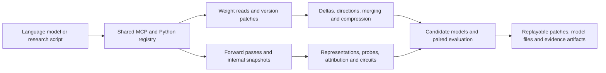

# WSP-toolkit implementation inventory

2026-11-09. Current source version: `0.4.0a5.dev0`. All **34 tool entries and 47 named methods** in the design catalog are integrated. The host registers models; the Python registry and native MCP interface provide tool discovery. Tools are exposed according to backend capabilities, dependencies, and permissions.

Entry points: [project status](../PROJECT_STATUS.md) · [homepage](../README.md) · [installation and usage](mcp-tools.md) · [detailed design](tool-design.md) · [machine-readable catalog](tool-catalog.json).

## How tools fit together

The foundation wraps PyTorch, Transformers, Safetensors, and PEFT. The analysis layer reuses existing algorithms and saved snapshots. Different methods produce patches or artifacts in common formats, so later tools can reference their IDs directly.

## Implementations and basic validation

Each example uses a real model, real forward pass, or real training samples. Entries on the same row share examples; methods are selected through parameters of the original tool.

| Tool entry | Integrated capabilities | Implementation and runnable examples |
|---|---|---|
| `register_model`, `describe_model` | Pinned checkpoints, fingerprints, model capabilities and observable sites | [Registration](../src/weight_programming/model_registry.py), [service](../src/weight_programming/inspection.py); [dual-entry example](../examples/mcp_inspection.py) |
| `list_tensors`, `read_tensor` | Paginated weight listing, original-precision slices and source versions | [Storage](../src/weight_programming/tensor_store.py); [example](../examples/mcp_inspection.py) |
| `create_patch`, `apply_patch`, `revert_patch` | Original-precision patches, parent validation, candidates and reversion | [Versions and patches](../src/weight_programming/patches.py); [complete example](../examples/mcp_patch.py) |
| `export_patch`, `import_patch`, `export_model` | Cross-workspace replay and complete checkpoint export and reload | [Implementation](../src/weight_programming/patches.py); [example](../examples/mcp_patch.py) |
| `model_forward` | Generation, given-text scoring and classification; residual, feed-forward and attention snapshots | [Forward service](../src/weight_programming/forward_service.py), [encoder](../src/weight_programming/encoder_backend.py); [generation](../examples/mcp_inspection.py), [classification](../examples/mcp_classification.py) |
| `read_artifact`, `get_run`, `list_tools` | Array slices, paginated details, run status, usage and available tools | [Artifacts](../src/weight_programming/artifacts.py), [registry](../src/weight_programming/tool_registry.py); [example](../examples/mcp_inspection.py) |
| `execute_python` | Linux isolated sessions, persistent variables, weight and array exchange, patch proposals | [Implementation](../src/weight_programming/python_tools.py); [real Qwen3 example](../examples/mcp_python.py) |
| `analyze_weight_delta` | Candidate or native PEFT LoRA deltas, layer changes, exact and randomized low-rank directions, actual rounding error | [Implementation](../src/weight_programming/delta_tools.py); [delta](../examples/mcp_delta.py), [PEFT](../examples/mcp_native_peft.py) |
| `project_weight` | Explicit direction or mean difference of two activation sets; project selected columns after validating output coordinates | [Service](../src/weight_programming/inspection.py), [existing direction algorithms](../src/weight_programming/directions.py); [example](../examples/mcp_delta.py) |
| `merge_updates` | Task-vector weighting, TIES and DARE for patches and registered adapters | [Implementation](../src/weight_programming/editing_tools.py); [patch](../examples/mcp_patch.py), [adapter](../examples/mcp_native_peft.py) |
| `prune_and_compensate` | Wanda, fixed-mask SparseGPT and adaptive SparseGPT | [Wrapper](../src/weight_programming/editing_tools.py), [reconstruction](../src/weight_programming/reconstruction.py); [example](../examples/mcp_patch.py) |
| `compress_update` | Ordinary or input-weighted low-rank truncation, per-tensor rank budgets and optional dense patches | [Implementation](../src/weight_programming/delta_tools.py); [example](../examples/mcp_delta.py), [rank allocation](../examples/mcp_native_peft.py) |
| `evaluate_variants`, `score_preferences` | Paired development-set evaluation, per-question intervals, answer probabilities and margins relative to a reference | [Implementation](../src/weight_programming/evaluation_tools.py); [evaluation](../examples/mcp_evaluation.py), [probability and attribution](../examples/mcp_representation.py) |
| `compare_models` | Same-coordinate weights, linear CKA, development-set behavior and joint dictionaries | [Implementation](../src/weight_programming/comparison_tools.py); [behavior](../examples/mcp_evaluation.py), [joint dictionary](../examples/mcp_features.py), [cross-architecture](../examples/mcp_classification.py) |
| `scan_lens` | Direct vocabulary readout, tuned lens and divergence from the final distribution | [Implementation](../src/weight_programming/representation_tools.py); [direct readout](../examples/mcp_representation.py), [fitting and verification](../examples/tuned_lens.py) |
| `probe_representation` | Held-out linear probes, control labels, input baseline and LEACE concept erasure | [Implementation](../src/weight_programming/representation_tools.py); [classification](../examples/mcp_classification.py), [LEACE](../examples/mcp_concept_erasure.py) |
| `attribute_output` | Token integrated gradients and contrastive margin attribution for two complete answers | [Implementation](../src/weight_programming/attribution_tools.py); [example](../examples/mcp_representation.py) |
| `run_intervention`, `localize_behavior` | Replacement, ablation, direction injection, LEACE; exact scans and AtP* gradient screening with verification | [Intervention](../src/weight_programming/intervention_tools.py), [AtP*](../src/weight_programming/attribution_patching.py); [intervention and screening](../examples/mcp_intervention.py), [concept erasure](../examples/mcp_concept_erasure.py) |
| `render_evidence` | Activation, intervention, attention, similarity and attribution heatmaps, plus directed graphs | [Implementation](../src/weight_programming/evidence_tools.py); [heatmaps](../examples/mcp_intervention.py), [directed graph](../examples/mcp_attention_rollout.py) |
| `extract_features` | Sparse autoencoders, two-source joint dictionaries, response samples and reconstruction errors | [Implementation](../src/weight_programming/feature_tools.py); [public and joint dictionaries](../examples/mcp_features.py) |
| `trace_circuit` | Attention rollout and maximum flow, path patching, ACDC, EAP and Circuit Tracer feature attribution graphs | [Circuits](../src/weight_programming/edge_tracing.py), [feature graphs](../src/weight_programming/feature_circuits.py); [attention](../examples/mcp_attention_rollout.py), [edge interventions](../examples/mcp_circuits.py), [feature graph](../examples/mcp_feature_circuit.py) |
| `compress_model` | Layer removal, Taylor feed-forward channel pruning, SliceGPT, GPTQ and AWQ | [Structural tools](../src/weight_programming/structure_tools.py), [separate-environment wrapper](../src/weight_programming/compression_exports.py); [training and structure](../examples/mcp_training.py), [slicing](../examples/mcp_slicegpt.py), [quantization](../examples/mcp_quantization.py) |
| `train_update` | LoRA, DPO, sequence distillation and post-pruning recovery, saving PEFT and general factors | [Implementation](../src/weight_programming/training_tools.py); [real one-step training](../examples/mcp_training.py) |
| `edit_facts` | ROME and MEMIT patches, paraphrases and neighboring-fact controls | [Implementation](../src/weight_programming/fact_tools.py); [real example](../examples/mcp_fact_editing.py) |

## Real execution results

These figures come from the tool examples and check implementation, saving, reading, and reloading.

| Example | Observed result |
|---|---|
| SmolLM2 read-only dual entry | Python and MCP agree on weights, activations and generation replay; activation shape is `1 × 5 × 576` |
| Patch, replay and reload | 1 BF16 weight element changed; the first residual channel changed from 2.421107 to 2.393364. Reversion, cross-workspace replay and full reload agreed |
| Deltas and directions | Singular values of two known changes were 0.5 and 0.125; a rank 1 update stored 2,112 parameters; paired-activation direction projection matched the formula elementwise |
| Native PEFT | Two rsLoRA targets retained ranks 2 and 3; actual scales were 4.242641 and 5.196152. Import, analysis, randomized direction decomposition, merging and exported forward passes were checked |
| DistilBERT and SST-2 | Maximum classification-score error against direct inference on 16 real samples was 0; the probe scored 7/8 on 8 held-out examples, versus 4/8 for the control; 6 attention layers and a classification-bias patch were checked |
| Cross-architecture CKA | DistilBERT and SmolLM2 used representations of their respective last valid tokens for the same eight texts; example similarity was 0.109967 |
| Qwen3 attention | Checked 28 Qwen3-0.6B layer snapshots, a `5 × 5` rollout matrix, `1 × 5` maximum-flow matrix and directed graph; the same example also ran on 30 SmolLM2 layers |
| Tuned lens | Across 4 held-out SmolLM2 prompts, mean first-layer KL from the final distribution decreased from 24.64 to 0.55. Lower KL indicates closer predictive distributions |
| LEACE | On 16 held-out noun and verb examples, the linear probe changed from 15/16 to 8/16 after erasure; the transform comes from the authors' library |
| Edge-level circuits | ACDC retained 1 of 4 candidate edges; on held-out inputs, output KL with the selected edge retained was 0.00059, versus 0.54039 for a same-size random selection |
| Feature attribution graph | A small fitted real dictionary produced 219 nodes, including 32 feature nodes; the full matrix was saved and graph edges checked; output KL with dictionary-only replacement was 4.465409 |
| SliceGPT | Hidden width changed from 576 to 384 and parameters from 134,515,008 to 127,180,800; strict reload and forward pass succeeded |
| GPTQ and AWQ | Original weights occupied 269,060,552 bytes; exports occupied 113,175,416 and 114,029,456 bytes, respectively, with 210 packed tensors each; both reloaded and ran on CPU |
| Four training methods | LoRA, DPO, sequence distillation and post-pruning recovery each completed a real training step; reloaded PEFT matched the saved effective factors |

The feature attribution graph report retains the gap between original and replacement models. The demonstration dictionary's output KL is 4.47; consult reconstruction-error nodes and the fidelity report when using it to explain a specific behavior.

## Environments and support

| Backend or plugin | Environment and scope |
|---|---|
| Qwen3, Llama, DistilBERT | Transformers 4.57.6; CPU or one CUDA GPU. Classifiers provide predictions and observations; generative models provide vocabulary readout, generation and validated interventions |
| Qwen3.5 | Separate Transformers 5.3.0 environment; hybrid attention declares capabilities per layer. Real observation records are retained in the research documentation |
| Native PEFT | PEFT 0.21.2, linear LoRA; the library resolves actual scaling and transpose rules. Additional adapter transformations require separate validation |
| Circuit Tracer | Separate environment: Circuit Tracer 0.5.0, NNsight 0.6.0, Transformers 4.57.3; requires per-layer dictionaries and gradient permission |
| Quantization | Separate LLM Compressor 0.15.0; outputs compressed-tensors packed weights |
| SliceGPT | Separate environment pinned to upstream commit `183cd92d8469bf3f1e979585a08dc382692bfbed`; Llama checkpoint |
| ROME, MEMIT | Pinned EasyEdit source and separate environment; requires weight-edit and gradient permissions |
| Persistent Python | Linux and Bubblewrap; host grants Python and weight-write permissions separately |

See [tool usage](mcp-tools.md) for installation commands, data acquisition and full example arguments. Future experiments will select extension candidates such as EWC, ReFT and role distillation from the research directory; the design catalog retains their respective candidate statuses.

## Where to continue

When modifying a tool, first inspect registration definitions in `src/weight_programming/inspection.py`, then the relevant module. New algorithms are added as a `method` parameter of an existing tool; backends resolve model differences. `examples/` contains actual usage for each capability group.

The public repository is `ZeroTang05/WSP-toolkit`, branch `main`. `SOURCE_MANIFEST.json` records release-file digests. Use `git rev-parse HEAD` to query the current source commit.

This development and validation used a local CPU. Downloaded models and data remain in the local cache; examples automatically clean up temporary model artifacts. Complete 0.6B effectiveness experiments and the 4B professional multi-agent workflow continue under their research protocols. Tool development delivers the interfaces, methods, examples and inspectable artifact formats listed here.
