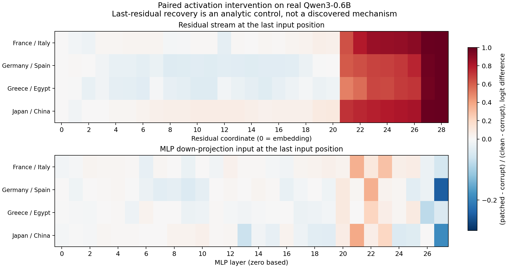

# Paired Activation Interventions: From Observed Differences to Causal Effects

This report preserves the experimental setup, results, and status at the time of writing. See [Project status](../../PROJECT_STATUS.md) for current progress.

2026-11-07. An executable diagnostic tool and a real Qwen3-0.6B experiment are complete. This study measures activation interventions; it does not evaluate mathematical capability gains or persistent parameter edits.

## Method Sources and Implementation

[Zhang and Nanda, ICLR 2024](https://arxiv.org/abs/2309.16042v2) systematically study input corruptions and metric choices in activation patching. This implementation runs clean, corrupt, and patched forward passes, retains multiple metrics, and records alignment and corruption assumptions explicitly. It connects statistical observations to causal diagnosis without automatically determining a correct weight edit.

The tool reads and writes **residual-stream activations** and **intermediate channels in gated MLPs**, performing **counterfactual activation replacement**. A channel does not automatically represent an independent, nameable capability. The model's full computation cannot be treated as a directly readable, semantically labeled flow of neuron signals.

`ActivationPatchingStudy.run` supports residual-stream and `down_proj` input activations, with optional position and channel selection. Inputs must have equal token lengths, and positions must be specified explicitly. It records the original logit difference, target probability, target log-probability, their changes, and normalized effects. Temporary hooks are removed on exceptions; a model execution lock prevents interference with concurrent weight-snapshot requests. The implementation is in `src/weight_programming/patching.py`.

This tool belongs to an independent mechanistic-diagnosis extension. The original WSP permissions for read-only forward passes and direct parameter programming exclude these interventions. Their results therefore do not count toward the original independent 50-pass experiment. See [Permissions and method assumptions](../../docs/tool-permissions.md).

## Experiment

The study uses four manually written capital-completion pairs: France/Italy, Germany/Spain, Japan/China, and Greece/Egypt. Each pair replaces one country token. Both prompts contain 5 tokens, and each target or comparison city is a single token. The base model runs on CPU in FP32 without training or weight changes.

For each pair, the scan tests 29 residual coordinates and 28 MLP input sites, replacing the full vector at the final input position. An additional control replaces embeddings at all positions. There are 232 paired requests and 696 actual model forward passes: 232 successes, 0 failures, and 164.33 seconds recorded by the script. This is the diagnostic study's budget, separate from the original WSP protocol budget.

For a single-token target, define `LD = logit(target) − logit(alternative)`. The intervention effect is `LD_patched − LD_corrupt`; its normalized value divides this effect by `LD_clean − LD_corrupt`. This metric is not accuracy and is not restricted to [0,1].

| Input pair | Clean LD | Corrupt LD | MLP layer with largest positive effect | LD improvement | Normalized change |
|---|---:|---:|---:|---:|---:|
| France/Italy | 4.721 | −9.113 | 21 | 4.912 | 35.51% |
| Germany/Spain | 9.738 | −8.839 | 22 | 6.591 | 35.48% |
| Japan/China | 8.477 | −7.750 | 21 | 6.132 | 37.79% |
| Greece/Egypt | 8.847 | −9.181 | 22 | 3.886 | 21.55% |

Layer indices start at 0. These sites were found by this scan; they are not tool defaults and do not establish editing sites for the original Qwen3.5 mathematics experiment.

[Standalone PDF](../../docs/figures/patching-map.pdf). Raw results, protocol, budget, and recomputed analysis are in `artifacts/toolkit/activation-patching-v1/Qwen3-0.6B/`. Complete per-request records remain on the server, bound to source and data hashes.

## Analysis

**Interventions have clear directional differences.** Replacing the layer 22 MLP input for Germany/Spain improves the logit difference by 6.591. At layer 27, the replacement reduces it by 4.574, a normalized change of −24.62%. An activation from the clean prompt can conflict with paths that remain in the corrupt state; these results do not establish that a layer is universally harmful.

**Positive controls do not establish a discovered mechanism.** Replacing the final residual with its clean value reproduces the clean result through the same downstream normalization and readout. Final-residual and full-embedding controls have zero error for all four pairs, confirming intervention boundaries and readout consistency. They do not establish discovery of a critical circuit. The final input token itself is unchanged, so replacing only its embedding is also a zero-effect control.

**Temporary recovery leaves a gap to permanent repair.** Local activation replacements recover approximately 21.6%–37.8% of the logit difference. This does not directly determine a weight-matrix edit or establish capability preservation on general inputs. Follow-up work requires failures from real tasks, multiple corruptions, position/channel isolation, random controls, and full-task confirmation of persistent parameter candidates.

The evidence establishes context-dependent positive and negative causal effects on a real model. It complements the four-model block-influence and layer-deletion study. The studies use different data and metrics, so their figures do not jointly identify a single mathematical mechanism.
