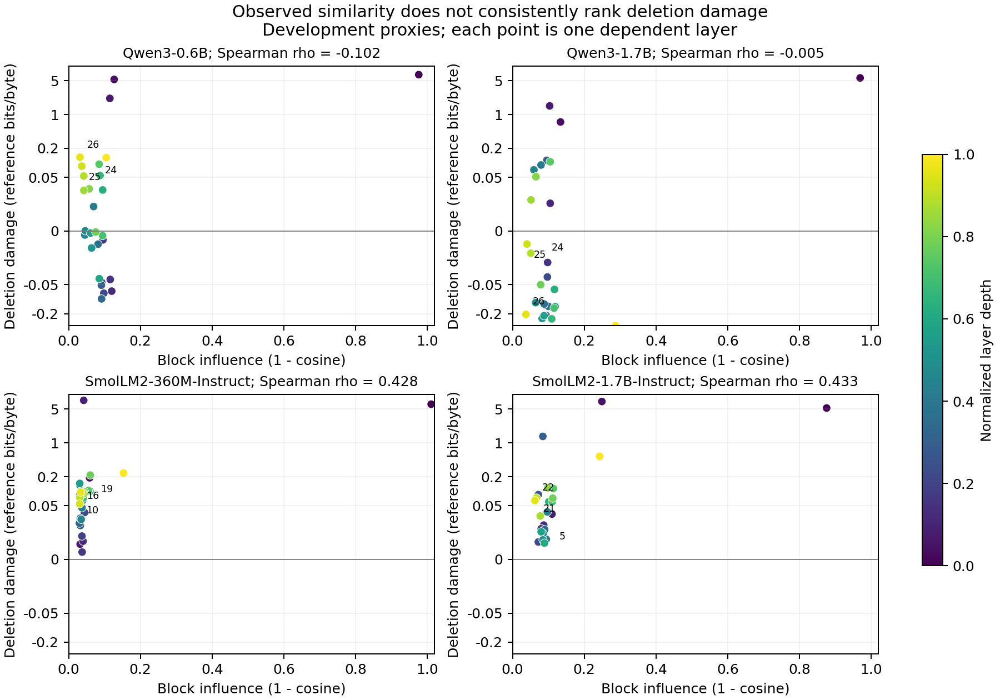

# Four-Model Layer Observation and Deletion: Why Causal Confirmation Matters

This report preserves the experimental setup, results, and status at the time of writing. See [Project status](../../PROJECT_STATUS.md) for current progress.

2026-11-07. Observation and individual layer deletion are complete for all four models, using the previously frozen `programming-expansion-v1` study. These are substantive measurements rather than an additional execution check, and they do not establish full generation capability.

## Method and Measurements

[ShortGPT](https://arxiv.org/abs/2403.03853) defines Block Influence through cosine changes between layer inputs and outputs. This adaptation uses 128 training-derived calibration texts, averages token changes within each example, and then averages across examples. It does not weight examples by their token counts. Each layer is then removed individually. Measurements use 64 independent training-derived development texts for changes in reference-answer bits/byte, and 32 ARC validation examples for cross-entropy changes in length-normalized option scores.

Deletion is an actual intervention on the execution graph. Every condition starts from the base model, removes one layer, and restores it afterward. Positive damage means a worse proxy metric; negative damage means an improvement. Reference-answer likelihood and the ARC proxy do not replace public generation accuracy or official `acc_norm`.

## Results

| Model | Layers | Spearman: BI vs. domain damage | Spearman: BI vs. ARC proxy damage | Layers whose deletion improves the domain proxy |
|---|---:|---:|---:|---:|
| Qwen3-0.6B | 28 | −0.102 | 0.244 | 14 |
| Qwen3-1.7B | 28 | −0.005 | 0.121 | 18 |
| SmolLM2-360M-Instruct | 32 | 0.428 | −0.155 | 0 |
| SmolLM2-1.7B-Instruct | 24 | 0.433 | 0.157 | 0 |

The 112 separate layer-deletion conditions share models and inputs, so they are not 112 independent statistical samples. Spearman correlations describe rankings within each model. No independent-sample p-values are assigned to dependent layers, and these correlations do not establish confirmed differences between model families.

The vertical axis uses `symlog`: positive values indicate proxy degradation, negative values improvement. The three lowest-BI layers of each model are labeled; color indicates layer depth. [Exportable PDF](../../docs/figures/layer-observation-analysis.pdf).

## Implications for Tool Design

**Similarity does not establish removability.** Qwen3-0.6B has its lowest BI at layer 26, yet removing that layer causes +0.130 bits/byte domain damage and +0.081 ARC proxy damage. At the same relative layer 26 of Qwen3-1.7B, the changes are −0.207 and −0.226 respectively. Similar positions and similarly low BI do not imply the same direction of local effect.

**Task definitions change rankings.** SmolLM2-360M has a domain correlation of +0.428 and an ARC proxy correlation of −0.155. Observation scores from one domain do not guarantee preservation of a guard task. `Observation` must bind its data distribution and metric, and `EditPlan` must include preservation constraints.

**Proxy improvements require confirmation.** Several Qwen layer deletions reduce reference-answer loss, potentially through output style, probability allocation, or other changes. The evidence does not establish stronger reasoning or repaired computational loops. The next step is full GSM8K, ARC-C, and HellaSwag evaluation of the frozen BI-selected, random, and tail-deletion candidates. Development proxies do not redefine public test results.

These results support a workflow of statistical candidate generation, actual intervention checks, multilayer combination validation, and full-task confirmation. Single-layer effects cannot simply be added to predict multilayer deletion, because layers interact and combinations must be executed again. The study does not establish that ShortGPT is generally ineffective or that statistical observation tools should be discarded.

## Evidence and Reproduction

Protocols, per-layer records, selectors, source, and completion records for the four models are stored locally at `artifacts/public/programming-expansion-v1/<model>/probe/`. `src/analyze_layer_observations.py` recomputes correlations, checks them against completion records, and binds outputs to input hashes. Figures use standard Matplotlib. At the time of this report, the full public evaluation matrix was still running; unfinished task scores are not reported here.
