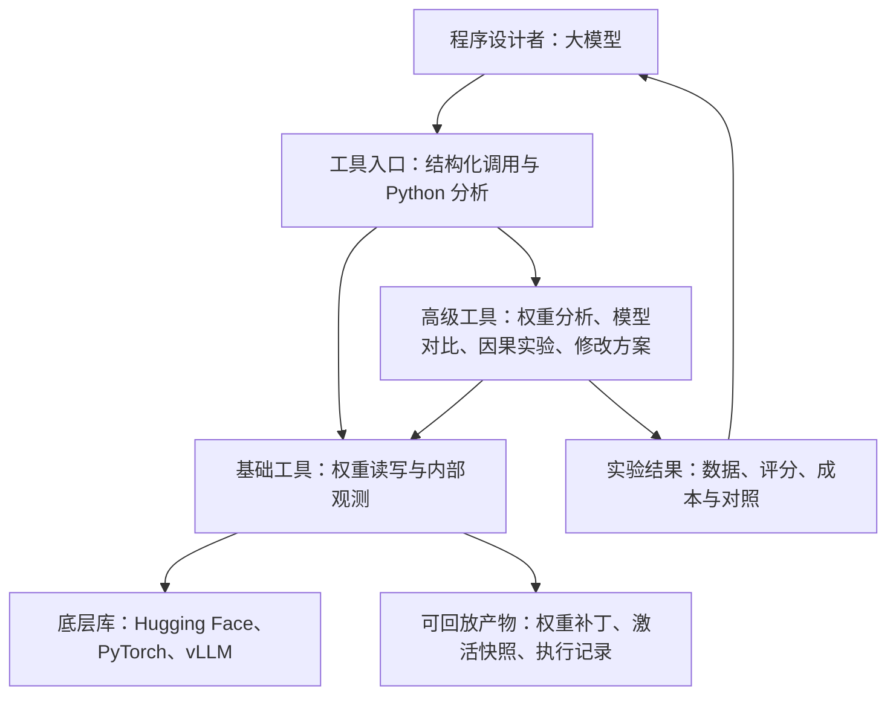

# WSP-toolkit 工具架构调研

2026-11-08。**WSP-toolkit 为研究者和大模型提供模型观测、解释、干预、权重编辑与评测工具。** 底层库负责计算和文件读写。本文记录架构参照和方法来源。现有实现、接口与建设顺序以[通用工具设计](wsp-toolkit-tool-design.md)为准。

## OpenWSP 给出的参照

OpenWSP 把权重存储、持久 Python 内核和前向执行放在共同的接口后面。其 MCP（模型连接工具的协议）提供张量列表、受限的切片读取、Python 执行、前向运行、编辑保存、差分查看、分析和补丁导入导出。它的分析代码已经计算主要变化方向、秩、方向余弦，以及方向与选定词元嵌入的关系。它也已经探索 vLLM 上的权重重载，并在更新后检查缓存和模型行为。因此这些都可以作为我们的基线能力。 [OpenWSP 架构](https://github.com/openwsp/openwsp/blob/8d09276736034f6874bb40e7019247c9541a5551/docs/architecture.md) · [MCP 工具清单](https://github.com/openwsp/openwsp/blob/8d09276736034f6874bb40e7019247c9541a5551/docs/mcp.md) · [方向分析](https://github.com/openwsp/openwsp/blob/8d09276736034f6874bb40e7019247c9541a5551/src/openwsp/inspection.py) · [vLLM 重载实现](https://github.com/openwsp/openwsp/blob/8d09276736034f6874bb40e7019247c9541a5551/src/openwsp/backends/vllm_weights.py)

MIT 原作实验 8 列出了持久 Python、读写权重和预算内前向能力。复现该实验时应按原协议设置权限。通用工具包可以另行提供临时激活干预、梯度分析、训练或压缩能力，并在每个实验里标明实际启用了哪些。另一个近邻项目 `weightspace` 也开放了张量切片、版本回退和可自定义的探针。WeightLoop 则研究如何让已有的权重修改程序用新的实测反馈重复工作。后续特色应通过真实工作流证明，尤其值得检验的是能否把**权重变化、内部计算变化、最终行为变化**串成一份可复查的分析。 [MIT 原作](https://rikiyat.github.io/blog/weight-space-programming/) · [实验 8 工具协议](https://github.com/RikiyaT/lm_understand-logs/blob/main/exp8_math/runs/p50c/turns/t001/prompt.txt) · [weightspace 项目](https://pypi.org/project/weightspace/0.2.0/) · [WeightLoop](https://arxiv.org/abs/2611.07319)

## 工具从八个方向设计

| 方向 | 需要覆盖的工作 | 返回给程序设计者的内容 |
|---|---|---|
| 1. 权重读写与版本管理 | 找到目标张量，按层或切片读取，在副本上应用、导出、回放、撤销修改 | 张量位置和形状、基座版本、补丁、修改范围 |
| 2. 内部观测与快照 | 运行目标模型，记录指定层、词元、注意力头或模块的中间数值和输出分数 | 可筛选的快照、统计摘要、可读取的数据文件 |
| 3. 微调变化分析 | 从原模型和训练后版本提取变化，找出变化集中在哪里、幅度多大、有哪些主要方向 | 分层差分、方向、排名、来源和比较条件 |
| 4. 两个模型的相似性 | 比较参数、相同输入的内部表示和最终回答，按模型之间的对应关系选择方法 | 层间相似度、逐题变化、对齐方式和适用范围 |
| 5. 因果定位 | 用替换、关闭、恢复、剂量扫描等干预，检验某个部件是否影响指定行为 | 可复查的干预对照、候选部件及效应大小 |
| 6. 生成和组合修改 | 把已定位的方向转成权重补丁，合并已有训练更新，剪枝、压缩或补偿 | 候选补丁、参数或资源变化、所用方法和条件 |
| 7. 评测和工作流 | 固定候选，在同一批题上测目标收益、副作用和运行成本，保存逐题结果 | 准确率、失败案例、成本和可重跑的配置 |
| 8. 给模型使用的入口 | 按当前能力列工具、查找目标、管理预算，允许查摘要后再读原始数据 | 参数明确的工具、结果编号、用量、可继续执行的状态 |

前两项是基础能力。第 3 至 7 项把基础能力编成分析和实验。第 8 项贯穿整个工具包，决定程序设计者能不能独立使用它们。

## 1–2. 基础接口怎么接底层库

| 底层库 | 可以复用的部分 | WSP-toolkit 补上的接口 |
|---|---|---|
| Hugging Face Hub 与 Safetensors | 按固定版本下载模型。Safetensors 是存储张量的文件格式，支持按名称和切片读取 | 统一的模型标识和张量位置，原始权重、候选修改、导出版本之间的对应关系。 [Hub 下载](https://huggingface.co/docs/huggingface_hub/en/guides/download) · [Safetensors](https://huggingface.co/docs/safetensors/index) |
| Transformers 与 PyTorch | 加载和保存模型、访问参数、在模块执行时挂接观测函数 | 用模型能理解的方式选择某层某个位置，绑定候选权重，收集对齐后的快照。 [Transformers 模型接口](https://huggingface.co/docs/transformers/en/main_classes/model) · [PyTorch 模块接口](https://docs.pytorch.org/docs/stable/generated/torch.nn.Module.html) |
| Hugging Face PEFT | 加载或合并轻量微调更新，例如 LoRA（用两块较小的矩阵表示修改） | 把训练更新转成与基座同坐标的实际变化，记录层、缩放设置和更新来源。 [PEFT 权重格式](https://huggingface.co/docs/peft/en/developer_guides/checkpoint) · [LoRA 接口](https://huggingface.co/docs/peft/en/package_reference/lora) |
| vLLM | 并行生成、运行变体，以及特定版本和格式的权重更新接口 | 用同一补丁在高吞吐后端评测，检查加载的版本和前缀缓存。前缀缓存是模型复用的旧输入计算，切换权重时需要按后端规则处理。 [vLLM 权重更新](https://docs.vllm.ai/en/latest/training/weight_transfer/) · [vLLM 异步更新说明](https://docs.vllm.ai/en/latest/training/async_rl/) |
| NNsight、TransformerLens、pyvene | 追踪中间值、缓存观测和配置临时干预 | 选一种兼容目标模型的实现作为插件，统一位置选择、快照格式和干预描述。 [NNsight 论文](https://arxiv.org/abs/2407.14561) · [TransformerLens](https://github.com/TransformerLensOrg/TransformerLens) · [pyvene 论文](https://arxiv.org/abs/2403.07809) |

建议让 **Transformers/PyTorch 承担精细分析，vLLM 承担批量评测**。两条路径共享模型版本、修改补丁和评测任务。vLLM 的推理格式可能分片、合并矩阵或量化，即以更少位数保存数值。支持热更新的版本和模型需要逐一验证，更新后核对固定输入的输出与缓存状态。实验入口应先声明支持哪些操作，例如「可观察普通注意力层」「可批量生成」「可直接加载该格式的补丁」。同一架构内也可能有不同类型的层，例如 Qwen3.5 的混合注意力。 [OpenWSP vLLM 更新验证](https://github.com/openwsp/openwsp/blob/8d09276736034f6874bb40e7019247c9541a5551/src/openwsp/backends/vllm_weights.py) · [本项目 Qwen3.5 适配](../src/weight_programming/qwen35_backend.py)

基础层建议固定三类产物。**权重补丁**记录改了哪一版模型的哪些张量和位置，区分计算中提案精度与实际落盘精度。**激活快照**记录哪版模型在哪些输入、层和词元位置产生了哪些中间值，区分输入阶段与逐词生成阶段，以及保留的是原始张量还是聚合统计。**实验记录**把补丁和快照绑定到运行参数、样本、打分规则和实际用量。同一个位置叫「第 15 层」仍可能指层输入、输出或某个子模块，快照要保留这个区别。 [OpenWSP 编辑格式](https://github.com/openwsp/openwsp/blob/8d09276736034f6874bb40e7019247c9541a5551/docs/edit-format.md) · [本项目前向服务](forward-service.md)

## 3–4. 把微调方向和模型相似性拆成三层证据

「两模型有多像」至少要回答三种不同问题。高级工具应按用户给出的模型关系自动选择适用的比较路线。

| 证据 | 可以计算什么 | 怎样使用 |
|---|---|---|
| 权重变化 | 同基座的逐张量差分、变化行列、范数、SVD（找出占主要变化的方向）、多个方向的重合程度、训练时间点的轨迹、合并时方向冲突 | 同基座、同参数坐标可直接相减。不同基座即使矩阵尺寸一样，也先检查部件对应关系。 [Task Arithmetic](https://arxiv.org/abs/2212.04089) · [Git Re-Basin](https://arxiv.org/abs/2209.04836) |
| 内部表示 | 用同一批输入跑两边，比较层的中间数值或其结构。CKA（比较两边怎样区分同一批输入）和 SVCCA（比较主要变化方向里的关联）适合做层间比较 | 两边使用同一批样本和明确的词元或文本片段对齐。同源同位置可做直接差分，不同宽度可用样本级相似度。 [CKA](https://proceedings.mlr.press/v97/kornblith19a.html) · [SVCCA](https://arxiv.org/abs/1706.05806) |
| 最终行为 | 比较逐题答案、正确率、重复或超长输出、目标词概率和运行成本 | 两模型分词方式不同时，优先比较同一文本任务的评分。逐词概率比较须先明确共同词表或比较对象。 [LM Evaluation Harness](https://github.com/EleutherAI/lm-evaluation-harness) |

工具应先确认两者的关系。**同一基座的微调版本**可以逐位置计算变化。**相同架构但独立训练的模型**可能只是调换了内部单元的顺序，先按架构验证能否对齐，再解释参数距离。**不同架构的模型**优先用同一批文本比较表示和任务行为。若要移植内部修改，需另行建立可检验的对应关系。 [Git Re-Basin](https://arxiv.org/abs/2209.04836) · [CKA](https://proceedings.mlr.press/v97/kornblith19a.html)

第一套高级工具可以做成 **「微调变化报告」**。输入基座与微调后模型或 LoRA，输出每层变化量、主要方向、实际改动范围，以及在指定输入上这些方向影响了哪些中间值和输出。普通 LoRA 可按实现的缩放将两个因子还原为有效矩阵更新。不同 LoRA 变体交给 PEFT 适配器处理。对比两个多方向更新时，还可以看两个主要方向集合之间的夹角。报告分别列整体指标和分层指标，避免大矩阵的变化遮住小层。 [LoRA](https://arxiv.org/abs/2106.09685) · [OpenWSP 现有几何分析](https://github.com/openwsp/openwsp/blob/8d09276736034f6874bb40e7019247c9541a5551/src/openwsp/inspection.py) · [本项目已有 LoRA 分析](../src/analyze_delta.py)

把变化方向接到实际计算上的一个简单办法，是让两个候选修改作用在**同一份基座激活**上。对线性层来说，可直接算 `ΔW × x`。这里 `ΔW` 是改了多少权重，`x` 是原模型送进这一层的数值，乘积表示该修改会怎样改变这一层的输出。它提供局部功能证据。最终仍需跑完整模型看后续层怎样处理这个变化。 [Task Arithmetic](https://arxiv.org/abs/2212.04089) · [本项目方向比较计划](mit-wsp-reproduction.md)

另有两类读懂表示的工具。Logit Lens（逐层词预测）把中间状态投到词表上看模型倾向。Tuned Lens（训练过的逐层词预测）使用额外训练的变换。线性探针用小模型预测某种概念，稀疏自编码器把复杂激活分解为较容易查看的特征。这些方法适合作为可选高级分析，结果要记录所用训练数据、层和特征字典。 [Tuned Lens](https://arxiv.org/abs/2303.08112) · [稀疏特征分析](https://transformer-circuits.pub/2024/scaling-monosemanticity)

如果手上还有训练数据和训练时保存的多个模型版本，可以继续分析训练过程中哪个方向先出现，以及哪些训练样本可能影响指定行为。TRAK 是训练数据归因的一种参照，应作为有额外数据和计算要求的插件。更广义的权重空间研究还包括从程序或生成模型构造权重。Tracr 可以把特定语言描述的算法编译成小型 Transformer 权重，适合作为行为已知的工具验证案例。 [TRAK](https://arxiv.org/abs/2303.14186) · [Tracr](https://arxiv.org/abs/2301.05062) · [权重空间研究综述](https://arxiv.org/abs/2603.10090)

## 5–6. 从发现线索到提出权重修改

| 工作 | 值得封装的研究方法 | 工具包应该负责的部分 |
|---|---|---|
| 检验某个部件是否影响行为 | 激活替换、关闭指定部件、恢复测试，必要时先用梯度近似排候选 | 记录同一批输入上的原始、受扰、恢复三组结果，写清位置、指标和干预幅度。允许梯度的近似定位单列权限，并用直接干预复核关键候选。 [激活替换方法研究](https://arxiv.org/abs/2309.16042) · [AtP*](https://arxiv.org/abs/2403.00745) |
| 改一类有明确目标的回答 | 方向投影、ROME 单事实编辑、MEMIT 批量事实编辑 | 接收目标和数据，输出可审阅补丁，记录相关任务的变化和无关任务的影响。ROME/MEMIT 作为知识编辑插件，声明所需数据和优化权限。 [ROME](https://arxiv.org/abs/2202.05262) · [MEMIT](https://arxiv.org/abs/2210.07229) · [EasyEdit](https://aclanthology.org/2024.acl-demos.9/) |
| 组合已有的多个训练更新 | 任务向量加减与缩放，TIES 的冲突处理，DARE 的随机保留与缩放 | 统一同基座的更新表示，输出合并前后的范数、冲突和候选版本。通用合并库可作为执行插件。 [Task Arithmetic](https://arxiv.org/abs/2212.04089) · [TIES](https://arxiv.org/abs/2306.01708) · [DARE](https://arxiv.org/abs/2311.03099) · [MergeKit](https://aclanthology.org/2024.emnlp-industry.36/) |
| 用更少的权重或计算保持能力 | Wanda 评分剪枝、SparseGPT 局部补偿、结构剪枝、量化和低秩压缩 | 分开记录校准数据、删了什么、如何补偿、最终权重格式和评测结果。结构变化、精度变化与部署速度各有证据。 [Wanda](https://arxiv.org/abs/2306.11695) · [SparseGPT](https://arxiv.org/abs/2301.00774) · [LLM-Pruner](https://arxiv.org/abs/2305.11627) · [LLM Compressor](https://github.com/vllm-project/llm-compressor) |

一个完整例子是「减少数学推理循环」。先用练习题收集会循环和不会循环的输出，再选可以对齐的片段，抓取候选层的中间值。对重点部件做恢复或关闭实验，确认变化是否符合预期。程序设计者据此用 Python 写一版补丁，比较几种修改幅度。最后冻结候选，用独立测试题比较正确率、重复输出、长度截断和平均用量。找到的方向和原作方向，可以继续做同坐标和共同输入上的比较。 [MIT 实验 8](https://rikiyat.github.io/blog/weight-space-programming/) · [本项目独立评测协议](math500-evaluation.md)

## 7–8. 让模型能把工具连起来用

给模型两种入口。常用任务走**结构化工具**，例如「列出能观测的层」「对比这两个补丁」「用相同输入运行两版」。新想法走**持久 Python 工作区**，允许它读指定结果、写分析代码并提交候选修改。两边共享同一套权限和记录。命令行、Python 接口和 MCP 可以调用同一个服务层。 [OpenWSP 接口设计](https://github.com/openwsp/openwsp/blob/8d09276736034f6874bb40e7019247c9541a5551/docs/architecture.md)

工具输入应包含明确的模型、版本、位置、数据和预算。大矩阵用文件编号返回，正文先给维度、主要变化和少量预览。原始数据可以按切片再读。长任务提供运行编号、进度、产物和错误位置。记录由哪次观测产生哪个补丁，哪些题用于构造方案，哪些题用于最终确认。工作流中的每一步都能单独回放。对比程序设计者是否真的带来收益时，应使用相同工具和预算比较固定方案或简单搜索，并保留随机位置或同范数对照。 [OpenWSP MCP](https://github.com/openwsp/openwsp/blob/8d09276736034f6874bb40e7019247c9541a5551/docs/mcp.md) · [激活替换对照方法](https://arxiv.org/abs/2309.16042) · [本项目五条件范数对照](ties-merging-study.md)

## 从调研到工具实现

现有实现、接口归并与新增方法见[合并路线](wsp-toolkit-tool-design.md#9-已有实现与合并路线)。新论文按三个问题归类。它操作什么对象，例如激活、权重或输出。它提供什么能力，例如读取、比较或临时干预。它需要什么证据，例如准确的站点坐标、对照效应或完整任务结果。已有相同输入与输出时加方法或视图。需要独立管理新的对象时再增加工具入口，例如有专属模型和站点要求的稀疏字典。图表复用登记的数值产物。

可解释性工具可形成三种独立结果。BertViz、Ecco 和 LIT 提供观测和呈现方式，帮助选出要研究的部件。Tuned Lens、概念探针和稀疏字典从内部状态提取可读信息。激活替换、路径替换和回路筛选检验修改内部计算后输出怎样变化。每类方法的论文、现有工具落点和实现方案集中在[可解释性工具设计](wsp-toolkit-tool-design.md#10-可解释性工具实现)。 [BertViz](https://aclanthology.org/P19-3007/) · [Tuned Lens](https://arxiv.org/abs/2303.08112) · [Path Patching](https://arxiv.org/abs/2304.05969)
